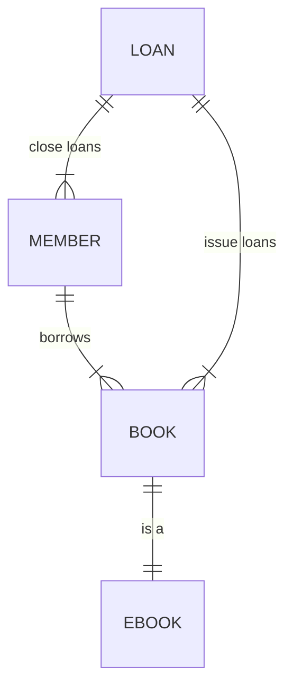
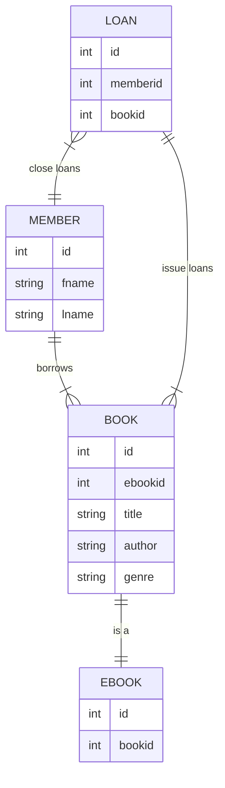

# Original Diagram

# Modified Diagram

## Convert modified diagram to tables & relations
### Object-Oriented
Book

| id  | ebookid | title             | author              |
| --- | ------- | ----------------- | ------------------- |
| 0   | 0       | The Crystal Shard | R.A. Salvatore      |
| 1   | 1       | House of Leaves   | Mark Z. Danielewski |

Ebook

| id  | bookid |
| --- | ------ |
| 0   | 0      |
| 1   | 1      |

Member

| id  | fname | lname |
| --- | ----- | ----- |
| 0   | Tim   | Smith |

Loan

| id  | bookid |
| --- | ------ |
| 0   | 0      |
| 1   | 1      |

MemberLoan -- In order to reduce redundancy. 

| memberid | loanid |
| -------- | ------ |
| 0        | 0      |
| 0        | 1      |
### E/R Style
Member

| id  | fname | lname |
| --- | ----- | ----- |
| 0   | Tim   | Smith |

Book

| id  | ebookid | title             | author              | genre   |
| --- | ------- | ----------------- | ------------------- | ------- |
| 0   | 0       | The Crystal Shard | R.A. Salvatore      | fantasy |
| 1   | 1       | House of Leaves   | Mark Z. Danielewski | horror  |

Ebook

| id  | bookid |
| --- | ------ |
| 0   | 0      |
| 1   | 1      |

Loan

| id  | memberid | bookid |
| --- | -------- | ------ |
| 0   | 0        | 0      |

Borrows

| memberid | bookid |
| -------- | ------ |
| 0        | 0      |
### Using NULL Values
Book

| id  | ebookid | title             | author              | genre   |
| --- | ------- | ----------------- | ------------------- | ------- |
| 0   | 0       | The Crystal Shard | R.A. Salvatore      | fantasy |
| 1   | NULL    | House of Leaves   | Mark Z. Danielewski | horror  |

Ebook

| id  | bookid |
| --- | ------ |
| 0   | 0      |
| 1   | NULL   |

Loan -- In the case that a loan has been initiated but not completed. 

| id  | memberid | bookid |
| --- | -------- | ------ |
| 0   | 0        | 0      |
| 1   | 0        | NULL   |
