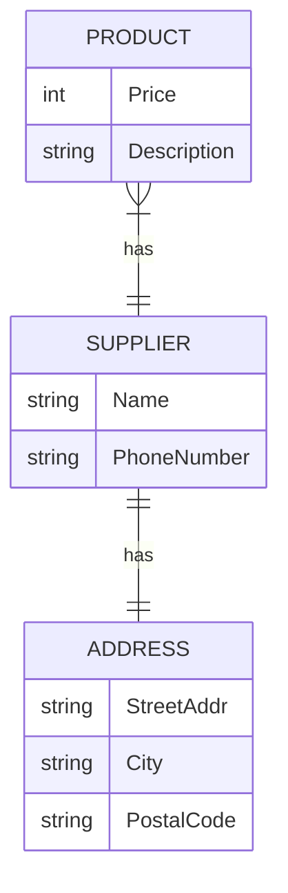
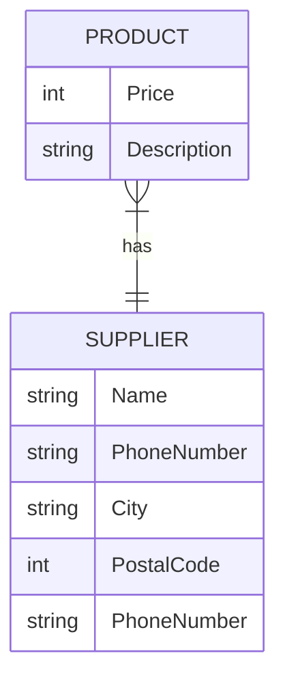
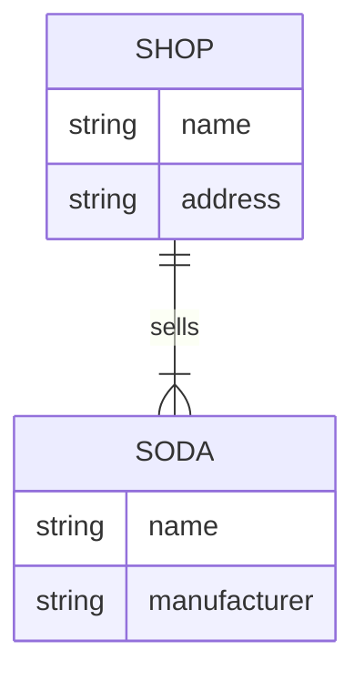
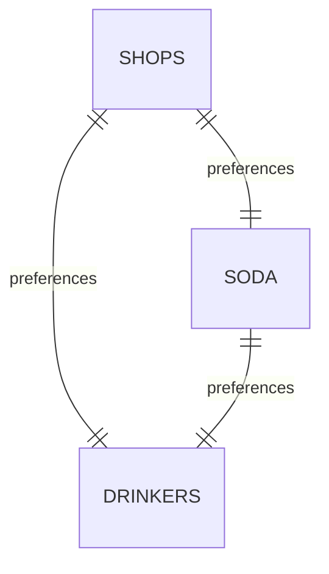
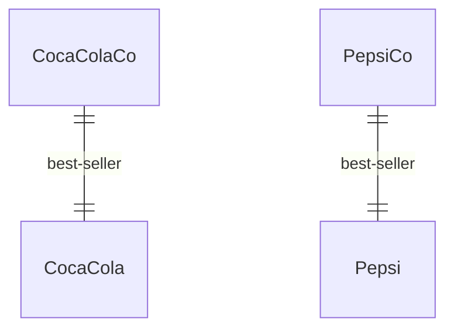
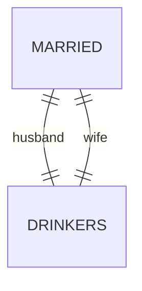
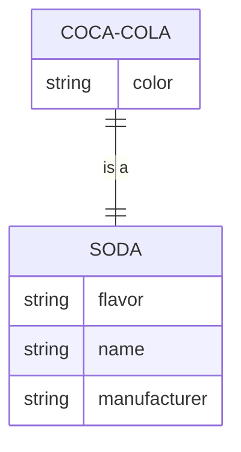
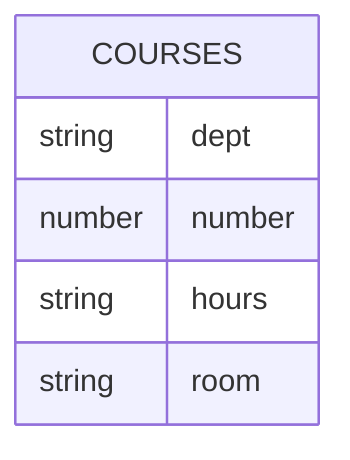
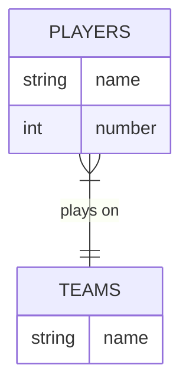

# Elements of the E/R Model
- An entity is an object. An object can have attributes. 
- An entity set is a collection of similar entities. 
- An attribute is a property of an entity set. 
## Examples
### Library
**Entities:** Book, author, member, loan
**Book attributes:** Title, publication date, ISBN
### Online shopping
**Entities:** customer, order, product, payment
**Customer attributes:** email, phone number, name, rewards id, address
# Database design
Conceptual design
- Build a model independent of the DBMS.
Logical design
- Create the database in a given DBMS.
Physical design
- How the database is stored in hardware.
# E/R Modeling
Modeling is used for conceptual design. A model includes:
- Entities - usually a noun
- Attributes - usually a verb
- Relationships - links between entities
## Entity Sets
A set of multiple entities.
## Cardinality Ratios
- Zero-to-one
- One-to-one
- One-to-many
- Many-to-many
	- This cardinality can lead to redundancy. It's best to break it into two one-to-many relationships. 
## Instances
A relationship R that connects n entity sets has an instance. In other words, an occurrence of one entity that has its own attributes. 

For example: (Ben, 1234567890, 123 main st) is a relationship set for the current instance of R. This is equivalent to one table within the database. 

| Name | Phone #    | Street      |
| ---- | ---------- | ----------- |
| Ben  | 1234567890 | 123 main st |
## Attributes

Improved ER diagram -- merged SUPPLIER and ADDRESS

## Relationships
Includes:
- Name
- Entity set
- Degree - the number of entities that can participate
- Cardinality
### Relationship Sets
Describes the relationship between multiple instances of entities. 

A relationship set of this ER would look like this:

| shop  | sells     |
| ----- | --------- |
| Joe's | Fanta     |
| Joe's | Sprite    |
| Sue's | Fanta     |
| Sue's | Coca-Cola |
| Sue's | Zero      |
### Three-way Relationships

## Multiplicity
In a one-to-one relationship, an entity can only be assigned to exactly one entity.

In a many-to-one relationship, an entity can be assigned to 0 or more entities. 

## Roles

### Drinkers Table

| ID  | Name         | Favorite Drink |
| --- | ------------ | -------------- |
| 001 | John Smith   | CocaCola       |
| 002 | Ruby Jackson | Sprite         |
### Married Table

| ID  | Drinker ID 1 | Drinker ID 2 | Marriage Date |
| --- | ------------ | ------------ | ------------- |
| 01  | 001          | 002          | 1-1-25        |
# Subclasses

## E/R vs. OOP Subclasses
In OO, objects are in one class only. Subclasses inherit from super classes.

In contrast, E/R entities have representatives. 
### Soda Table

| SodaID | SodaName | Flavor  | Manufacturer  |
| ------ | -------- | ------- | ------------- |
| 001    | Cola     | Classic | Coca Cola Co. |
| 002    | Lemonade | Lemon   | Xy Co.        |
| 003    | Fanta    | Classic | Coca Cola co. |
### Coca Cola Table
| SodaID | SodaName | Flavor  | Manufacturer  | Color  |
| ------ | -------- | ------- | ------------- | ------ |
| 001    | Cola     | Classic | Coca Cola Co. | Brown  |
| 003    | Fanta    | Classic | Coca Cola co. | Orange |
# Keys
A key is a set of attributes for one entity set such that no two entities in this set can have all the attributes of the key. 
## Keys in E/R Diagrams
In this example, the name attribute **name** is a key for **Soda**

## Multi-attribute Key
Entities can have multiple keys. In this example **dept** and **number** are both keys. The key must be unique, which is why this can be useful when entities have the same value for one key.

For example:

| dept | number |
| ---- | ------ |
| MTH  | 001    |
| CSE  | 001    |
These courses can have the same course number, but still be uniquely identified by combining both the **department** and **number** attributes. 
# Weak Entity Sets

