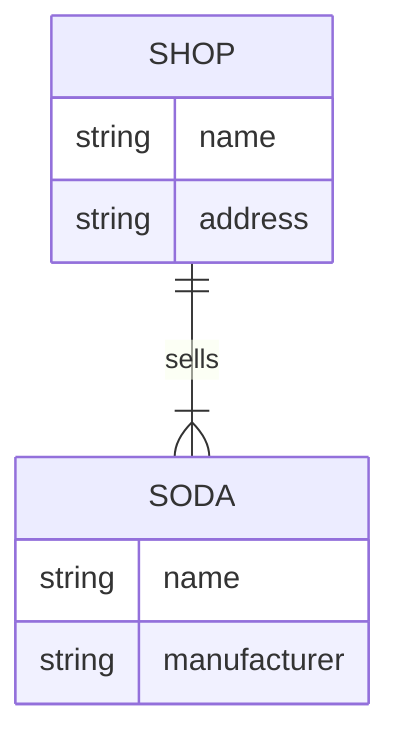
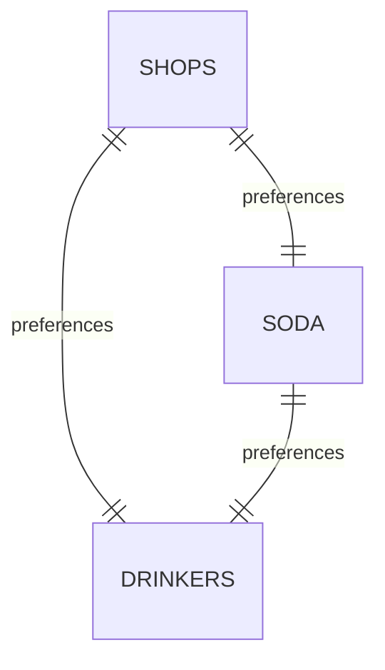
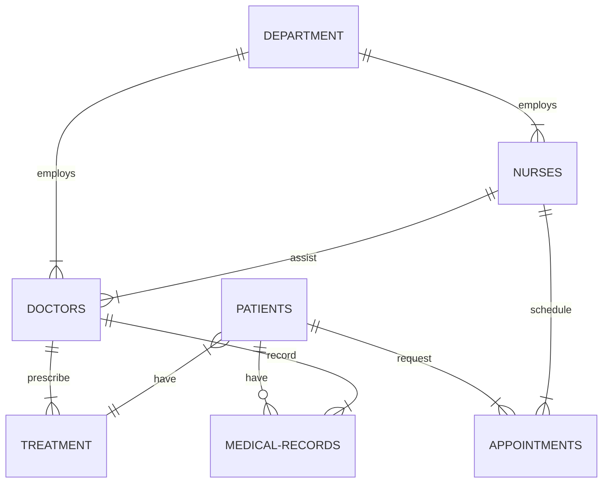
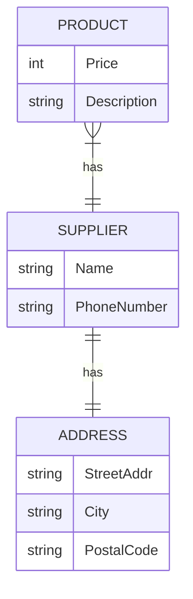
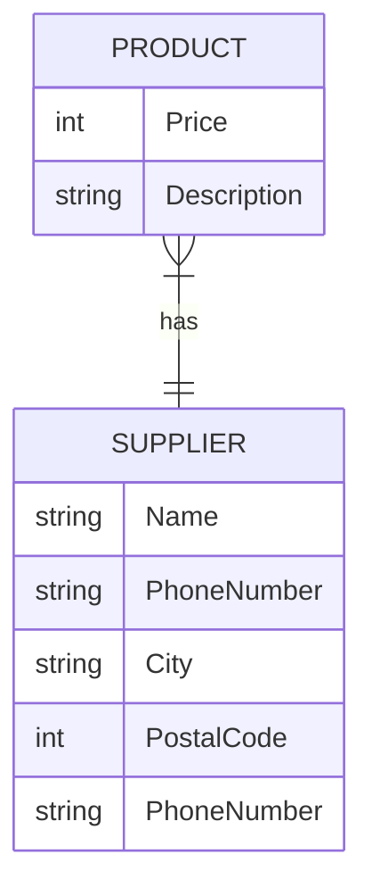

# Elements of the E/R Model
- An entity is an object. An object can have attributes. 
- An entity set is a collection of similar entities. 
- An attribute is a property of an entity set. 
## Examples
![[example-erd.png]]
### Library
**Entities:** Book, author, member, loan
**Book attributes:** Title, publication date, ISBN
### Online shopping
**Entities:** customer, order, product, payment
**Customer attributes:** email, phone number, name, rewards id, address
# Database design
Conceptual design
- Build a model independent of the DBMS.
Logical design
- Create the database in a given DBMS.
Physical design
- How the database is stored in hardware.
# E/R Modeling
Modeling is used for conceptual design. A model includes:
- Entities - usually a noun
- Attributes - usually a verb
- Relationships - links between entities
## Relationships
Includes:
- Name
- Entity set
- Degree - the number of entities that can participate
- Cardinality
### Relationship Sets

A relationship set of this ER would look like this:

| shop   | sells     |
| ------ | --------- |
| Joe's  | Fanta     |
| Joe's  | Sprite    |
| Sue's  | Fanta     |
| Sue's  | Coca-Cola |
| Sue's  | Zero      |
### Three-way Relationships

## Cardinality Ratios
- Zero-to-one
- One-to-one
- One-to-many
- Many-to-many
	- This cardinality can lead to redundancy. It's best to break it into two one-to-many relationships. 
## Instances
A relationship R that connects n entity sets has an instance. 

For example: (Ben, 1234567890, 123 main st) is a relationship set for the current instance of R. This is equivalent to one table within the database. 

| Name | Phone #    | Street      |
| ---- | ---------- | ----------- |
| Ben  | 1234567890 | 123 main st |
## Example
1. Patients
2. Doctors
3. Nurses
4. Department
5. Appointment
6. Treatment
7. Medical Card

## Solving Redundancies

| ID  | Name  | Price | Qunatity |
| --- | ----- | ----- | -------- |
| 001 | Dress | 50    | 10       |
| 002 | Shoes | 60    | 2        |

| ID  | Location | Capacity |
| --- | -------- | -------- |
| 101 | NY       | 50       |
| 102 | MI       | 30       |

| ID  | PRODID | WID | Quantity |
| --- | ------ | --- | -------- |
| 01  | 001    | 101 | 10       |
| 02  | 001    | 101 | 10       |
| 03  | 002    | 102 | 30       |
Example ER with attributes

Improved ER diagram -- merged SUPPLIER and ADDRESS

