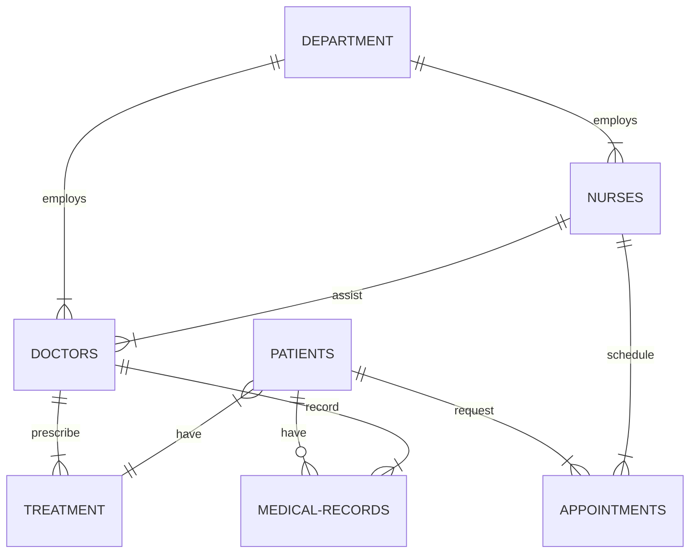

# Hospital Example
Entities:
1. Patients
2. Doctors
3. Nurses
4. Department
5. Appointment
6. Treatment
7. Medical Card

## Example as a Table
Each entity is represented as a table within an actual database design. Each ID can be referred to as a **primary key**, since it is used to identify each instance of an entity. 
### Patient Table

| ID  | Name        | DOB    | Insurance ID | SSN   | Address     |
| --- | ----------- | ------ | ------------ | ----- | ----------- |
| 01  | John Smith  | 1/1/01 | 123456789    | 12446 | 123 main st |
| 02  | Sarah Kline | 1/2/01 | 124524136    | 1346  | 124 main st |
### Doctor table

| ID  | Name         | Specialization   |
| --- | ------------ | ---------------- |
| 01  | Frank Castle | Physical Therapy |
### Nurse Table

| ID  | Name      | Role                         |
| --- | --------- | ---------------------------- |
| 01  | Tim Kline | Assistant Physical Therapist |
### Appointment Table
The Patient, Doctor, and Nurse IDs in this table are referred to as **foreign keys**. This is because they are primary keys of another table. 

| ID  | Patient ID | Doctor ID | Nurse ID | Date   | Time   |
| --- | ---------- | --------- | -------- | ------ | ------ |
| 01  | 01         | 01        | 01       | 1/1/25 | 5:30PM |
