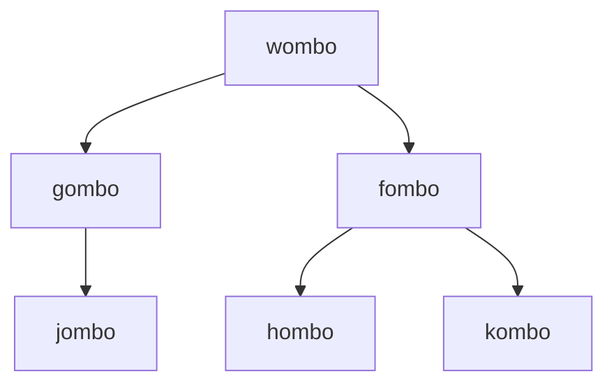
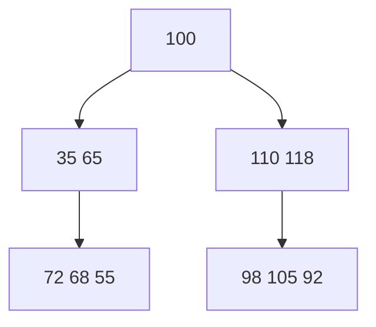

# Stack Efficiency in [[Algorithmic Analysis|Big O]]
- Push: O(1)
- Pop: O(1) - remove the element on top
- Read from the top: O(1)
# Queue Efficiency in Big O
- Enqueuing: O(1)
- Dequeuing: O(1) (unless it's a standard array, which would be O($n$))
- Reading from the front of the queue: O(1)
## Priority Queue Efficiency
- Enqueuing: O($log(n)$)
- Dequeuing: O($log(n)$)
- Reading from the front of the queue: O(1)
### Starvation
Starvation in queuing is when lower priority items never get served because there are too many higher priority items being added. There are ways to get around this by having an age system where the older an item is, the more likely it is to supersede higher priority items. 
# Trees
Trees are data structures that store elements hierarchically. 

There is only ever one root. Leaf nodes are nodes that don't have any children. The parent of the root node is `NULL`. 



hombo & jombo have a depth of 2.
## Traversal
- Preorder: From the root, start at the left and move to the right.
	- `wombo, gombo, jombo, fombo, hombo, kombo`
- Postorder: Start at the very left and move right, ending at the root.
	- `jombo, gombo, hombo, kombo, fombo, wombo`
- Inorder: Start at the left, traverse up to the root, then traverse to the right
	- `jombo, gombo, wombo, hombo, fumbo, kombo`
## Binary Search Trees
A ordered tree in which:
- Every node has at most two children
- Each child is labeled as either a left child or a right child
- The left child precedes the right child

A binary tree is different. 
### Binary Tree
![[Pasted image 20250415112012.png]]
### Binary Search Tree
![[Pasted image 20250415112034.png]]
## Balanced vs Unbalanced
A balanced binary tree has left and right subtrees where each node differ in height by no more than 1. This makes operations like search, inserting, and delete more efficient. 

An unbalanced binary tree doesn't maintain the height balance. The example below might as well be a [[linked lists|linked list]].
```
    1
     \
      2
       \
        3
         \
          4
```

This is why insertion order matters. 
# B-Trees
These are NOT the same as binary trees. It stands for Balanced Tree. No matter what order values are inserted into a b-tree, the tree stays balanced. Whenever a node is inserted, the tree is re-shuffled. Additionally, multiple numbers can be stored inside a single node. 


## Efficiency
- Searching: O($log(n)$)
- Inserting: O($log(n)$)
- Deleting: O($log(n)$)