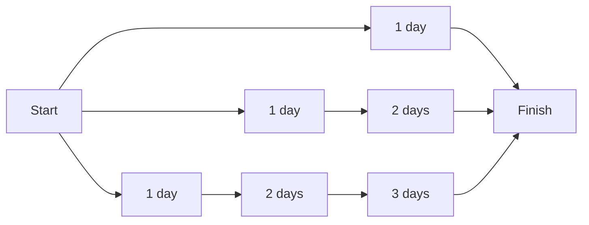
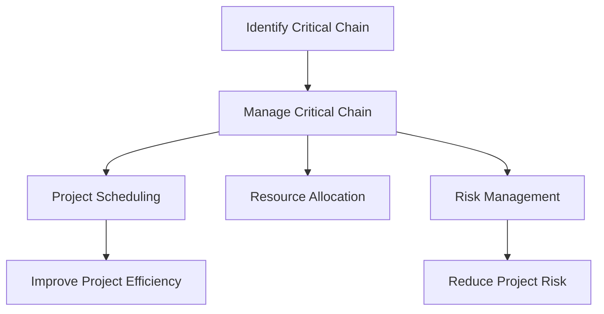

# Schedule Management
A milestone is a significant event that normally has no duration. It acts as a marker and is not set in stone. 

The FBI failed to have good schedule management when designing the Trilogy (2006) and Sentinel (2007) systems. 

The more people assigned to a project, the more likely it is to fail. Books related to it:
- The Mythical Man Month
## Sequence Activities
Sequencing involves evaluating the reasons for different types of dependencies. 

Task dependencies are tasks that rely on another task begins or is finished. 
## Developing the Schedule
Good tools to develop a schedule are:
- Gantt charts
- Critical path analysis
- Critical chain scheduling
- [PERT analysis]([Program evaluation and review technique - Wikipedia](https://en.wikipedia.org/wiki/Program_evaluation_and_review_technique))
### Gantt Charts
Provide a standard format for displaying project schedule information. Milestones are used often in Gantt charts as they emphasize important accomplishments. 

```mermaid
gantt
    dateFormat HH:mm
    axisFormat %H:%M
    Initial milestone : milestone, m1, 17:49, 2m
    Task A : 10m
    Task B : 5m
    Final milestone : milestone, m2, 18:08, 4m
```

### Critical Path Method
A method for identifying the sequence a set of tasks need to occur in and how long each sequence will take. 

### Critical Chain Scheduling
A diagramming method that lists each task and the resources required to complete them in order to manage the resources' availability when needed. 

# Words of caution on PM software
- Many software programs use templates or sample files
- PMs should be careful to not rely too much on templates
- Don't ignore the unique concerns of your particular project