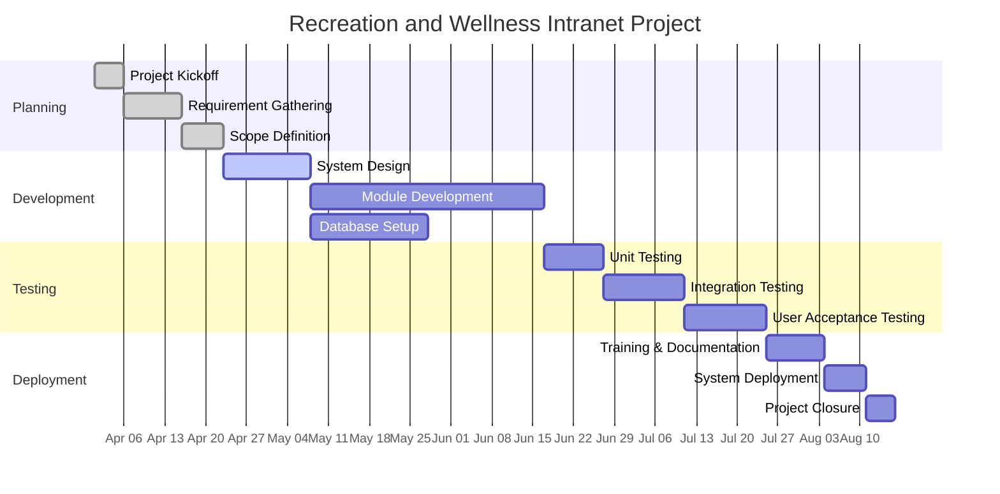

# Part 1
## Task 1 - Table & Memo
---
**To**: Senior Management, Manage Your Health, Inc. (MYH)  
**From**: Michael Vitale
**Date**: 4/7/2025  
**Subject**: Evaluation of Proposed IT Projects

As part of MYH’s strategic initiative to reduce costs, enhance cross-selling, and leverage new web-based technologies, the IT department has proposed four key projects. Below is a summary of each project, its alignment with business goals, estimated benefits, and cost considerations.

**Project Summary Table**

| Project Name                        | Strategic Goal Alignment                          | Estimated Benefits                            | Estimated Cost |
|-------------------------------------|------------------------------------------------|-----------------------------------------------|----------------|
| **Recreation and Wellness Intranet Project** | Reduce healthcare costs by improving employee health | Saves $30 per full-time employee per year by lowering premiums | $200,000 (6 months) |
| **Health Coverage Costs Business Model** | Track and optimize healthcare expenses          | Saves $20 per full-time employee per year; better insurance negotiations | $100,000 |
| **Cross-Selling System**            | Increase revenue through better product bundling | Increases profits by $1M annually for 3 years | $800,000 per year |
| **Web-Enhanced Communications System** | Improve efficiency in product/service delivery   | Saves $2M per year for 3 years                | $3M (1st year), 20% annual maintenance |
**Initial Recommendations**
1. **Recreation and Wellness Intranet Project** – Strong potential for cost savings; aligns with strategic goals to reduce employee healthcare costs.
2. **Health Coverage Costs Business Model** – Moderate cost but offers valuable financial insight and better insurance negotiations.
3. **Cross-Selling System** – High profit potential but requires significant investment in development and maintenance.
4. **Web-Enhanced Communications System** – Largest upfront cost but expected to deliver long-term efficiency gains and savings.

Each project provides strategic benefits, but prioritization should be based on return on investment and alignment with MYH’s immediate objectives.

**Next Steps**

- Conduct a weighted scoring evaluation of these projects.
- Prepare a detailed business case for the top-priority initiative(s).
- Develop a project charter for execution readiness.

Please review this summary and provide guidance on the prioritization of these initiatives.

**Sincerely,**  
Michael Vitale
IT Project Manager
## Task 2 - Weighted Scoring Model
---
**Weighted Scoring Model Report**

**Introduction** This report presents the evaluation of four proposed IT projects for Manage Your Health, Inc. (MYH) using a weighted scoring model. The projects were assessed based on key criteria: financial benefit, strategic alignment, implementation cost, and feasibility. Each project was assigned scores based on these criteria, and a weighted total score was calculated.

**Scoring Summary** The table below summarizes the weighted scoring model results:

|Project Name|Total Weighted Score|
|---|---|
|Recreation and Wellness Intranet|8.5|
|Health Coverage Costs Business Model|7.9|
|Cross-Selling System|7.0|
|Web-Enhanced Communications System|7.6|

A bar chart was also created to visualize these results, highlighting the comparative strengths of each project.

**Analysis of Results**

1. **Recreation and Wellness Intranet Project (8.5)** – This project received the highest score due to its strong alignment with business goals and potential cost savings through improved employee health.
2. **Health Coverage Costs Business Model (7.9)** – While not the highest-scoring project, it offers valuable insights into healthcare expenses, which can lead to long-term cost reductions.
3. **Web-Enhanced Communications System (7.6)** – This project offers significant cost savings but has a high initial implementation cost, reducing its feasibility.
4. **Cross-Selling System (7.0)** – Although this project has strong financial benefits, it ranked lower due to higher costs and moderate feasibility challenges.

**Recommendations** Based on the analysis, the **Recreation and Wellness Intranet Project** is the most promising and should be prioritized. The **Health Coverage Costs Business Model** is also a strong candidate, particularly for long-term cost management. The **Web-Enhanced Communications System** and **Cross-Selling System** provide financial benefits but may require further analysis to justify the high implementation costs.

**Conclusion** This weighted scoring model provides a structured approach to project selection, ensuring alignment with MYH’s strategic goals. Based on these findings, management should consider moving forward with the highest-ranked projects to maximize business value.

```chart
type: bar
labels: [Recreation and Wellness, Health Coverage Costs, Cross-Selling System, Web-Enhanced Comm.]
series:
  - title: Weighted Score
    data: [8.5, 7.9, 7.1, 7.6]
```
## Task 3 - Business Case
---
**Business Case for the Recreation and Wellness Intranet Project**

**1. Executive Summary** The Recreation and Wellness Intranet Project aims to improve employee health, reduce healthcare costs, and enhance workplace wellness. By providing a dedicated intranet application for wellness programs, MYH can encourage employees to participate in recreational activities, manage their health effectively, and ultimately lower the company’s healthcare expenses.

**2. Business Objective** MYH pays 20% more than the industry average for employee healthcare premiums due to poor employee health. This project supports the company’s strategic goals by:

- Encouraging employee participation in health and wellness programs
- Reducing healthcare costs through improved employee health
- Offering incentives for employees to maintain healthy lifestyles

**3. Project Description** The intranet application will include the following features:

- Registration for recreational programs (e.g., soccer, jogging, bowling)
- Enrollment in wellness programs (e.g., weight management, stress reduction, smoking cessation)
- Tracking participation and health improvements
- Providing incentives and rewards for employees who achieve health goals

**4. Financial Benefits and Cost Analysis**

- Estimated cost: **$200,000** (development over six months)
- Expected savings: **$30 per full-time employee per year**
- Total savings over four years: **$2.4 million** (assuming 20,000 full-time employees)
- Additional benefits: Improved employee productivity and reduced absenteeism

**5. Risk Assessment** Potential risks and mitigation strategies include:

- **Low employee participation:** Implement strong communication and incentive programs.
- **Technical issues:** Use in-house IT resources to ensure seamless integration.
- **Lack of management buy-in:** Demonstrate financial benefits and alignment with strategic goals.

**6. Conclusion** The Recreation and Wellness Intranet Project is a cost-effective initiative that aligns with MYH’s business objectives. It has the potential to yield significant financial and health benefits, making it a priority investment for the company.
## Task 4 - Project Charter
---
**Project Charter: Recreation and Wellness Intranet Project**

**Project Title:** Recreation and Wellness Intranet Project  
**Project Sponsor:** Dr. Sharan Kalwani
**Project Manager:** Michael Vitale
**Date:** 4/7/2025

### **1. Project Purpose and Justification**

The Recreation and Wellness Intranet Project aims to improve employee health and reduce healthcare costs. MYH currently spends 20% more on employee healthcare premiums than the industry average due to poor employee health. This project will provide employees with access to wellness programs, recreational activities, and health-related tracking tools, resulting in healthier employees and lower healthcare costs.

### **2. Project Objectives**

- Develop an intranet application for wellness and recreational program registration.
- Encourage employee participation in company-sponsored health initiatives.
- Provide incentives to employees for achieving wellness goals.
- Reduce healthcare costs by at least $30 per full-time employee per year.
- Complete the project within **six months** and within a **$200,000** budget.

### **3. Project Scope**

- **In Scope:**
    - Web-based platform for employee wellness programs.
    - Registration system for health and recreational activities.
    - Tracking system for employee participation and progress.
    - Incentive and reward system.
- **Out of Scope:**
    - Mobile application development.
    - External partnerships with wellness providers.

### **4. Key Deliverables**

- Functional intranet application with registration and tracking capabilities.
- Employee incentives and rewards system.
- Documentation and user training materials.
- System testing and launch plan.

### **5. High-Level Timeline**

- **Month 1:** Requirements gathering and planning.
- **Month 2-3:** System development and initial testing.
- **Month 4:** System integration and user testing.
- **Month 5:** Training and deployment preparation.
- **Month 6:** System launch and monitoring.

### **6. Budget Estimate**

- **Total Budget:** $200,000
- **Major Cost Components:**
    - Development: $100,000
    - Testing & Integration: $50,000
    - Training & Documentation: $25,000
    - Incentives & Miscellaneous: $25,000

### **7. Key Stakeholders**

- **Project Sponsor:** Dr. Sharan Kalwani
- **Project Manager:** Michael Vitale
- **IT Department:** Development and support team
- **Human Resources:** Employee engagement and program promotion
- **Finance Department:** Cost analysis and reporting
- **Employees:** End users of the system

### **8. Risks and Assumptions**

**Potential Risks:**

- Low employee engagement → Mitigation: Offer attractive incentives.
- Technical integration challenges → Mitigation: Allocate additional testing time.
- Scope creep → Mitigation: Strict scope management and approvals.

**Assumptions:**

- Employees will actively participate in wellness programs.
- No additional hardware or software purchases are required.
- Project team has full support from management and HR.
## Task 5 - Change Request
---
**Change Request Form**

**Project Name:** Recreation and Wellness Intranet Project  
**Change Request ID:** CR-001  
**Date:** 4/9/2025
**Requested By:** Michael Vitale
**Project Manager:** Michael Vitale

### **1. Change Description**

The original project scope included basic tracking of employee participation in wellness programs. However, based on feedback from HR and employees, we propose enhancing the system to include a **personalized health dashboard** that provides users with tailored recommendations, progress tracking, and health improvement insights.

### **2. Justification for Change**

- **Increased Employee Engagement:** A personalized dashboard will encourage more employees to use the system actively.
- **Better Health Outcomes:** Employees can track their progress more effectively, leading to improved health and cost savings.
- **Alignment with Business Goals:** Enhanced functionality supports MYH’s goal of reducing healthcare costs through proactive wellness management.

### **3. Impact Analysis**

- **Scope Impact:** Expands system functionality to include personalized health analytics and insights.
- **Schedule Impact:** Extends project timeline by **4 weeks** (new estimated completion: **7 months** instead of 6).
- **Cost Impact:** Additional **$50,000** required for development and testing (new total budget: **$250,000**).
- **Risk Impact:** Potential delays in deployment, mitigated by adding extra development resources.

### **4. Approval Process**

- **Project Sponsor Review:** Required
- **IT and Development Approval:** Required
- **Finance Department Approval:** Required
- **HR Stakeholder Review:** Required

### **5. Recommendation**

Given the long-term benefits of increased employee participation and health improvements, this change is recommended for approval. The additional investment is justified by potential healthcare cost savings exceeding **$30 per employee per year**, further supporting MYH’s financial and strategic goals.
# Part 2
## Task 1 - Requirements Traceability Matrix
---

|Requirement ID|Description|Source|Priority|
|---|---|---|---|
|RQ-001|Employees must be able to register for recreational programs (soccer, jogging, bowling, etc.).|HR Department|High|
|RQ-002|Employees must be able to enroll in wellness programs (weight management, stress reduction, smoking cessation).|Employee Survey|High|
|RQ-003|The system must track employee participation and display progress in a user-friendly dashboard.|IT Department|Medium|
|RQ-004|The system must include an incentive program that rewards employees for achieving health goals.|HR & Finance|High|
|RQ-005|The application must be accessible via the company’s intranet and require secure login authentication.|IT Security Team|High|
## Task 2 - Scope Statement
---
### **1. Project Objectives**

The Recreation and Wellness Intranet Project aims to improve employee health and reduce healthcare costs for Manage Your Health, Inc. (MYH). This project will provide an intranet-based platform where employees can register for wellness and recreational programs, track participation, and receive incentives for achieving health goals. The project must be completed within **six months** and within a **$200,000** budget.

### **2. Project Scope Description**

The system will include:

- **Registration module** for employees to enroll in recreational and wellness programs.
- **Tracking system** to monitor participation and progress in these programs.
- **Incentive program** to reward employees for meeting wellness goals.
- **User-friendly dashboard** for employees to view their progress and upcoming activities.
- **Secure login and authentication** via the company’s intranet.

### **3. Key Deliverables**

- Fully functional intranet application with wellness program registration and tracking.
- Secure authentication and access control mechanisms.
- Employee incentive and rewards system.
- User training materials and documentation.
- System testing and deployment plan.

### **4. Project Constraints**

- The project must be completed within six months.
- The total budget cannot exceed $200,000.
- The system must run on the existing company intranet without additional hardware.
- All data must comply with internal security and privacy policies.

### **5. Assumptions**

- Employees will actively use the system to improve their health.
- No additional hardware purchases are required.
- HR and IT departments will provide necessary support for system implementation.

### **6. Out of Scope**

- Development of a mobile application.
- Integration with external healthcare providers.
- Advanced analytics beyond basic tracking and reporting.

### **7. Acceptance Criteria**

- The system must allow at least **90% of employees** to register and access wellness programs.
- User feedback should indicate at least **80% satisfaction** with system usability.
- The incentive program must be functional and operational upon launch.
- The system must pass security and performance testing before deployment.
## Task 3 - WBS
---
**1. Project Management**

- 1.1 Project Planning
- 1.2 Stakeholder Communication
- 1.3 Risk Management
- 1.4 Progress Reporting

**2. Requirements Definition**

- 2.1 Gather Employee and HR Requirements
- 2.2 Define System Functionalities
- 2.3 Approve Requirements Document

**3. System Design**

- 3.1 Database Design
- 3.2 User Interface (UI) Design
- 3.3 Security and Authentication Design

**4. System Development**

- 4.1 Develop Registration Module
- 4.2 Develop Tracking System
- 4.3 Develop Incentive Program
- 4.4 Implement Security Features

**5. Testing**

- 5.1 Unit Testing
- 5.2 Integration Testing
- 5.3 User Acceptance Testing

**6. Training and Documentation**

- 6.1 Develop User Training Materials
- 6.2 Conduct Employee Training Sessions
- 6.3 Create System Documentation

**7. Deployment and Support**

- 7.1 System Deployment
- 7.2 Post-Implementation Support
- 7.3 System Performance Review
## Task 4 - Gantt Chart
---

## Task 5 - Scope Validation & Change Control
---
### **1. Scope Validation Strategy**

Scope validation ensures that project deliverables meet the agreed requirements and receive formal acceptance from stakeholders. The following steps will be used to validate the scope of the Recreation and Wellness Intranet Project:

1. **Requirement Verification:**
    
    - Compare deliverables against the Requirements Traceability Matrix (RTM).
    - Conduct reviews with stakeholders (HR, IT, Finance) to confirm compliance.
2. **Stakeholder Review and Sign-off:**
    
    - Demonstrate system functionality to key stakeholders.
    - Collect formal approval from project sponsors and end-users.
3. **User Acceptance Testing (UAT):**
    
    - Employees will participate in system testing.
    - Gather feedback and address usability concerns before final deployment.
4. **Final Approval:**
    
    - Obtain written confirmation from HR and IT departments confirming that the system meets expectations.
    - Document sign-offs before project closure.

### **2. Change Control Strategy**

To prevent scope creep and ensure all modifications are managed efficiently, the following change control process will be implemented:

1. **Change Request Submission:**
    
    - Any stakeholder proposing a change must submit a Change Request Form.
    - The request must include justification, impact analysis, and urgency.
2. **Impact Analysis:**
    
    - Evaluate how the change affects the project scope, timeline, and budget.
    - Identify risks and required resources for implementation.
3. **Change Review and Approval:**
    
    - The Project Manager and Change Control Board (CCB) will review the request.
    - Changes exceeding a **10% impact on cost or schedule** require senior management approval.
4. **Implementation and Documentation:**
    
    - Approved changes will be integrated into the project plan.
    - Update the project schedule, scope statement, and WBS accordingly.
5. **Communication and Monitoring:**
    
    - Inform all relevant stakeholders about approved changes.
    - Monitor impact and ensure smooth execution without affecting critical deadlines.

### **Conclusion**

By implementing structured scope validation and change control processes, the Recreation and Wellness Intranet Project will maintain clear deliverables, prevent uncontrolled modifications, and ensure stakeholder satisfaction.