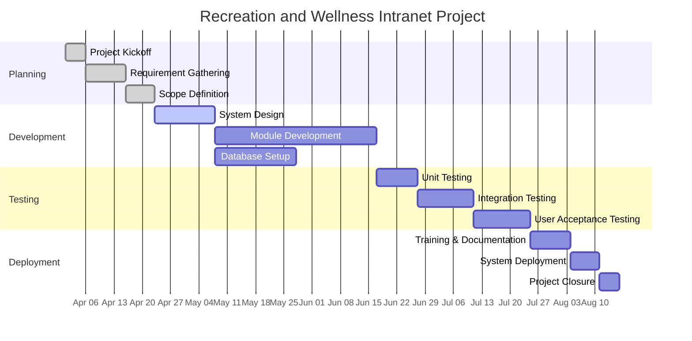
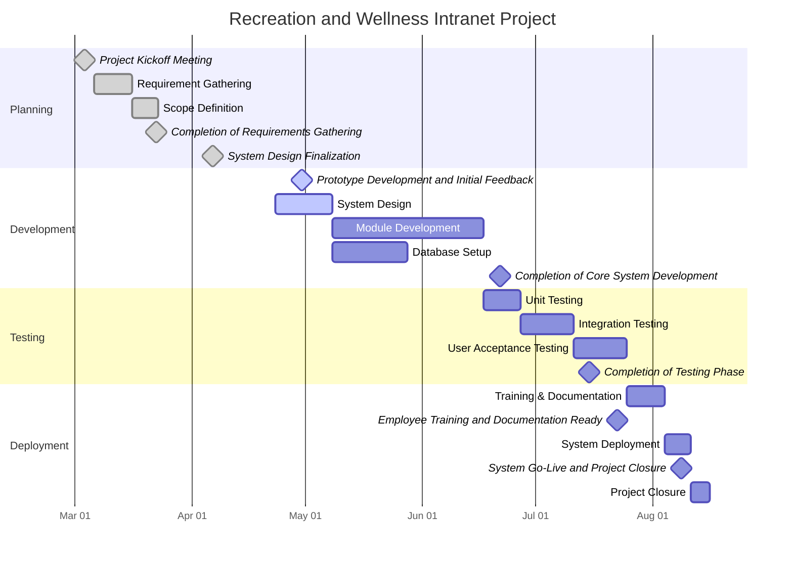

# Part 1
## Task 1 - Table & Memo
---
**To**: Senior Management, Manage Your Health, Inc. (MYH)  
**From**: Michael Vitale
**Date**: 4/7/2025  
**Subject**: Evaluation of Proposed IT Projects

As part of MYH’s strategic initiative to reduce costs, enhance cross-selling, and leverage new web-based technologies, the IT department has proposed four key projects. Below is a summary of each project, its alignment with business goals, estimated benefits, and cost considerations.

**Project Summary Table**

| Project Name                        | Strategic Goal Alignment                          | Estimated Benefits                            | Estimated Cost |
|-------------------------------------|------------------------------------------------|-----------------------------------------------|----------------|
| **Recreation and Wellness Intranet Project** | Reduce healthcare costs by improving employee health | Saves $30 per full-time employee per year by lowering premiums | $200,000 (6 months) |
| **Health Coverage Costs Business Model** | Track and optimize healthcare expenses          | Saves $20 per full-time employee per year; better insurance negotiations | $100,000 |
| **Cross-Selling System**            | Increase revenue through better product bundling | Increases profits by $1M annually for 3 years | $800,000 per year |
| **Web-Enhanced Communications System** | Improve efficiency in product/service delivery   | Saves $2M per year for 3 years                | $3M (1st year), 20% annual maintenance |
**Initial Recommendations**
1. **Recreation and Wellness Intranet Project** – Strong potential for cost savings; aligns with strategic goals to reduce employee healthcare costs.
2. **Health Coverage Costs Business Model** – Moderate cost but offers valuable financial insight and better insurance negotiations.
3. **Cross-Selling System** – High profit potential but requires significant investment in development and maintenance.
4. **Web-Enhanced Communications System** – Largest upfront cost but expected to deliver long-term efficiency gains and savings.

Each project provides strategic benefits, but prioritization should be based on return on investment and alignment with MYH’s immediate objectives.

**Next Steps**

- Conduct a weighted scoring evaluation of these projects.
- Prepare a detailed business case for the top-priority initiative(s).
- Develop a project charter for execution readiness.

Please review this summary and provide guidance on the prioritization of these initiatives.

**Sincerely,**  
Michael Vitale
IT Project Manager
## Task 2 - Weighted Scoring Model
---
**Weighted Scoring Model Report**

**Introduction** This report presents the evaluation of four proposed IT projects for Manage Your Health, Inc. (MYH) using a weighted scoring model. The projects were assessed based on key criteria: financial benefit, strategic alignment, implementation cost, and feasibility. Each project was assigned scores based on these criteria, and a weighted total score was calculated.

**Scoring Summary** The table below summarizes the weighted scoring model results:

|Project Name|Total Weighted Score|
|---|---|
|Recreation and Wellness Intranet|8.5|
|Health Coverage Costs Business Model|7.9|
|Cross-Selling System|7.0|
|Web-Enhanced Communications System|7.6|

A bar chart was also created to visualize these results, highlighting the comparative strengths of each project.

**Analysis of Results**

1. **Recreation and Wellness Intranet Project (8.5)** – This project received the highest score due to its strong alignment with business goals and potential cost savings through improved employee health.
2. **Health Coverage Costs Business Model (7.9)** – While not the highest-scoring project, it offers valuable insights into healthcare expenses, which can lead to long-term cost reductions.
3. **Web-Enhanced Communications System (7.6)** – This project offers significant cost savings but has a high initial implementation cost, reducing its feasibility.
4. **Cross-Selling System (7.0)** – Although this project has strong financial benefits, it ranked lower due to higher costs and moderate feasibility challenges.

**Recommendations** Based on the analysis, the **Recreation and Wellness Intranet Project** is the most promising and should be prioritized. The **Health Coverage Costs Business Model** is also a strong candidate, particularly for long-term cost management. The **Web-Enhanced Communications System** and **Cross-Selling System** provide financial benefits but may require further analysis to justify the high implementation costs.

**Conclusion** This weighted scoring model provides a structured approach to project selection, ensuring alignment with MYH’s strategic goals. Based on these findings, management should consider moving forward with the highest-ranked projects to maximize business value.

```chart
type: bar
labels: [Recreation and Wellness, Health Coverage Costs, Cross-Selling System, Web-Enhanced Comm.]
series:
  - title: Weighted Score
    data: [8.5, 7.9, 7.1, 7.6]
```
## Task 3 - Business Case
---
**Business Case for the Recreation and Wellness Intranet Project**

**1. Executive Summary** The Recreation and Wellness Intranet Project aims to improve employee health, reduce healthcare costs, and enhance workplace wellness. By providing a dedicated intranet application for wellness programs, MYH can encourage employees to participate in recreational activities, manage their health effectively, and ultimately lower the company’s healthcare expenses.

**2. Business Objective** MYH pays 20% more than the industry average for employee healthcare premiums due to poor employee health. This project supports the company’s strategic goals by:

- Encouraging employee participation in health and wellness programs
- Reducing healthcare costs through improved employee health
- Offering incentives for employees to maintain healthy lifestyles

**3. Project Description** The intranet application will include the following features:

- Registration for recreational programs (e.g., soccer, jogging, bowling)
- Enrollment in wellness programs (e.g., weight management, stress reduction, smoking cessation)
- Tracking participation and health improvements
- Providing incentives and rewards for employees who achieve health goals

**4. Financial Benefits and Cost Analysis**

- Estimated cost: **$200,000** (development over six months)
- Expected savings: **$30 per full-time employee per year**
- Total savings over four years: **$2.4 million** (assuming 20,000 full-time employees)
- Additional benefits: Improved employee productivity and reduced absenteeism

**5. Risk Assessment** Potential risks and mitigation strategies include:

- **Low employee participation:** Implement strong communication and incentive programs.
- **Technical issues:** Use in-house IT resources to ensure seamless integration.
- **Lack of management buy-in:** Demonstrate financial benefits and alignment with strategic goals.

**6. Conclusion** The Recreation and Wellness Intranet Project is a cost-effective initiative that aligns with MYH’s business objectives. It has the potential to yield significant financial and health benefits, making it a priority investment for the company.
## Task 4 - Project Charter
---
**Project Charter: Recreation and Wellness Intranet Project**

**Project Title:** Recreation and Wellness Intranet Project  
**Project Sponsor:** Dr. Sharan Kalwani
**Project Manager:** Michael Vitale
**Date:** 4/7/2025
### 1. Project Purpose and Justification
The Recreation and Wellness Intranet Project aims to improve employee health and reduce healthcare costs. MYH currently spends 20% more on employee healthcare premiums than the industry average due to poor employee health. This project will provide employees with access to wellness programs, recreational activities, and health-related tracking tools, resulting in healthier employees and lower healthcare costs.
### 2. Project Objectives

- Develop an intranet application for wellness and recreational program registration.
- Encourage employee participation in company-sponsored health initiatives.
- Provide incentives to employees for achieving wellness goals.
- Reduce healthcare costs by at least $30 per full-time employee per year.
- Complete the project within six months and within a $200,000 budget.
### 3. Project Scope
- In Scope:
    - Web-based platform for employee wellness programs.
    - Registration system for health and recreational activities.
    - Tracking system for employee participation and progress.
    - Incentive and reward system.
- Out of Scope:
    - Mobile application development.
    - External partnerships with wellness providers.
### 4. Key Deliverables
- Functional intranet application with registration and tracking capabilities.
- Employee incentives and rewards system.
- Documentation and user training materials.
- System testing and launch plan.
### 5. High-Level Timeline
- Month 1: Requirements gathering and planning.
- Month 2-3: System development and initial testing.
- Month 4: System integration and user testing.
- Month 5: Training and deployment preparation.
- Month 6: System launch and monitoring.
### 6. Budget Estimate
- Total Budget: $200,000
- Major Cost Components:
    - Development: $100,000
    - Testing & Integration: $50,000
    - Training & Documentation: $25,000
    - Incentives & Miscellaneous: $25,000
### 7. Key Stakeholders
- Project Sponsor: Dr. Sharan Kalwani
- Project Manager: Michael Vitale
- IT Department: Development and support team
- Human Resources: Employee engagement and program promotion
- Finance Department: Cost analysis and reporting
- Employees: End users of the system
### 8. Risks and Assumptions
Potential Risks:

- Low employee engagement → Mitigation: Offer attractive incentives.
- Technical integration challenges → Mitigation: Allocate additional testing time.
- Scope creep → Mitigation: Strict scope management and approvals.

Assumptions:

- Employees will actively participate in wellness programs.
- No additional hardware or software purchases are required.
- Project team has full support from management and HR.
## Task 5 - Change Request
---
**Change Request Form**

**Project Name:** Recreation and Wellness Intranet Project  
**Change Request ID:** CR-001  
**Date:** 4/9/2025
**Requested By:** Michael Vitale
**Project Manager:** Michael Vitale
### 1. Change Description
The original project scope included basic tracking of employee participation in wellness programs. However, based on feedback from HR and employees, we propose enhancing the system to include a personalized health dashboard that provides users with tailored recommendations, progress tracking, and health improvement insights.
### 2. Justification for Change
- Increased Employee Engagement: A personalized dashboard will encourage more employees to use the system actively.
- Better Health Outcomes: Employees can track their progress more effectively, leading to improved health and cost savings.
- Alignment with Business Goals: Enhanced functionality supports MYH’s goal of reducing healthcare costs through proactive wellness management.
### 3. Impact Analysis
- Scope Impact: Expands system functionality to include personalized health analytics and insights.
- Schedule Impact: Extends project timeline by 4 weeks (new estimated completion: 7 months instead of 6).
- Cost Impact: Additional $50,000 required for development and testing (new total budget: $250,000).
- Risk Impact: Potential delays in deployment, mitigated by adding extra development resources.
### 4. Approval Process
- Project Sponsor Review: Required
- IT and Development Approval: Required
- Finance Department Approval: Required
- HR Stakeholder Review: Required
### 5. Recommendation

Given the long-term benefits of increased employee participation and health improvements, this change is recommended for approval. The additional investment is justified by potential healthcare cost savings exceeding $30 per employee per year, further supporting MYH’s financial and strategic goals.
# Part 2
## Task 1 - Requirements Traceability Matrix
---

| Requirement ID | Description                                                                                                     | Source           | Priority |
| -------------- | --------------------------------------------------------------------------------------------------------------- | ---------------- | -------- |
| RQ-001         | Employees must be able to register for recreational programs (soccer, jogging, bowling, etc.).                  | HR Department    | High     |
| RQ-002         | Employees must be able to enroll in wellness programs (weight management, stress reduction, smoking cessation). | Employee Survey  | High     |
| RQ-003         | The system must track employee participation and display progress in a user-friendly dashboard.                 | IT Department    | Medium   |
| RQ-004         | The system must include an incentive program that rewards employees for achieving health goals.                 | HR & Finance     | High     |
| RQ-005         | The application must be accessible via the company’s intranet and require secure login authentication.          | IT Security Team | High     |
## Task 2 - Scope Statement
---
### 1. Project Objectives
The Recreation and Wellness Intranet Project aims to improve employee health and reduce healthcare costs for Manage Your Health, Inc. (MYH). This project will provide an intranet-based platform where employees can register for wellness and recreational programs, track participation, and receive incentives for achieving health goals. The project must be completed within six months and within a $200,000 budget.
### 2. Project Scope Description
The system will include:
- Registration module for employees to enroll in recreational and wellness programs.
- Tracking system to monitor participation and progress in these programs.
- Incentive program to reward employees for meeting wellness goals.
- User-friendly dashboard for employees to view their progress and upcoming activities.
- Secure login and authentication via the company’s intranet.
### 3. Key Deliverables
- Fully functional intranet application with wellness program registration and tracking.
- Secure authentication and access control mechanisms.
- Employee incentive and rewards system.
- User training materials and documentation.
- System testing and deployment plan.
### 4. Project Constraints
- The project must be completed within six months.
- The total budget cannot exceed $200,000.
- The system must run on the existing company intranet without additional hardware.
- All data must comply with internal security and privacy policies.
### 5. Assumptions
- Employees will actively use the system to improve their health.
- No additional hardware purchases are required.
- HR and IT departments will provide necessary support for system implementation.
### 6. Out of Scope
- Development of a mobile application.
- Integration with external healthcare providers.
- Advanced analytics beyond basic tracking and reporting.
### 7. Acceptance Criteria
- The system must allow at least 90% of employees to register and access wellness programs.
- User feedback should indicate at least 80% satisfaction with system usability.
- The incentive program must be functional and operational upon launch.
- The system must pass security and performance testing before deployment.
## Task 3 - WBS
---
**1. Project Management**
- 1.1 Project Planning
- 1.2 Stakeholder Communication
- 1.3 Risk Management
- 1.4 Progress Reporting

**2. Requirements Definition**
- 2.1 Gather Employee and HR Requirements
- 2.2 Define System Functionalities
- 2.3 Approve Requirements Document

**3. System Design**
- 3.1 Database Design
- 3.2 User Interface (UI) Design
- 3.3 Security and Authentication Design

**4. System Development**
- 4.1 Develop Registration Module
- 4.2 Develop Tracking System
- 4.3 Develop Incentive Program
- 4.4 Implement Security Features

**5. Testing**
- 5.1 Unit Testing
- 5.2 Integration Testing
- 5.3 User Acceptance Testing

**6. Training and Documentation**
- 6.1 Develop User Training Materials
- 6.2 Conduct Employee Training Sessions
- 6.3 Create System Documentation

**7. Deployment and Support**
- 7.1 System Deployment
- 7.2 Post-Implementation Support
- 7.3 System Performance Review
## Task 4 - Gantt Chart
---

## Task 5 - Scope Validation & Change Control
---
### 1. Scope Validation Strategy
Scope validation ensures that project deliverables meet the agreed requirements and receive formal acceptance from stakeholders. The following steps will be used to validate the scope of the Recreation and Wellness Intranet Project:
1. Requirement Verification:    
    - Compare deliverables against the Requirements Traceability Matrix (RTM).
    - Conduct reviews with stakeholders (HR, IT, Finance) to confirm compliance.
2. Stakeholder Review and Sign-off:    
    - Demonstrate system functionality to key stakeholders.
    - Collect formal approval from project sponsors and end-users.
3. User Acceptance Testing (UAT):    
    - Employees will participate in system testing.
    - Gather feedback and address usability concerns before final deployment.
4. Final Approval:    
    - Obtain written confirmation from HR and IT departments confirming that the system meets expectations.
    - Document sign-offs before project closure.
### 2. Change Control Strategy
To prevent scope creep and ensure all modifications are managed efficiently, the following change control process will be implemented:
1. Change Request Submission:    
    - Any stakeholder proposing a change must submit a Change Request Form.
    - The request must include justification, impact analysis, and urgency.
2. Impact Analysis:    
    - Evaluate how the change affects the project scope, timeline, and budget.
    - Identify risks and required resources for implementation.
3. Change Review and Approval:    
    - The Project Manager and Change Control Board (CCB) will review the request.
    - Changes exceeding a 10% impact on cost or schedule require senior management approval.
4. Implementation and Documentation:    
    - Approved changes will be integrated into the project plan.
    - Update the project schedule, scope statement, and WBS accordingly.
5. Communication and Monitoring:    
    - Inform all relevant stakeholders about approved changes.
    - Monitor impact and ensure smooth execution without affecting critical deadlines.
### Conclusion
By implementing structured scope validation and change control processes, the Recreation and Wellness Intranet Project will maintain clear deliverables, prevent uncontrolled modifications, and ensure stakeholder satisfaction.
# Part 3
## Task 1 - Additional Activities for Resource and Duration Estimation
---
### 1. Detailed User Requirement Analysis
- Description: Conduct in-depth sessions with employees and HR to refine system requirements.
- Reason: Ensures accurate development timelines and prevents scope changes later.
- Estimated Duration: 2 weeks
- Resources Required: Business analysts, HR representatives
### 2. Prototype Development and Feedback
- Description: Develop a basic prototype of the intranet system and collect early feedback from stakeholders.
- Reason: Helps identify usability issues early, reducing rework in later phases.
- Estimated Duration: 3 weeks
- Resources Required: UI/UX designers, developers, test users
### 3. Security and Compliance Assessment
- Description: Perform a security and compliance review to ensure data protection policies are met.
- Reason: Avoids potential legal or IT security issues post-launch.
- Estimated Duration: 2 weeks
- Resources Required: IT security specialists, compliance officers
### 4. Load and Performance Testing
- Description: Simulate high user traffic scenarios to evaluate system performance under stress.
- Reason: Ensures that the platform remains stable with company-wide usage.
- Estimated Duration: 2 weeks
- Resources Required: Developers, QA testers
### 5. Employee Training and Support Preparation
- Description: Create training materials and schedule training sessions for employees before launch.
- Reason: Ensures smooth adoption and reduces post-launch support requests.
- Estimated Duration: 3 weeks
- Resources Required: HR trainers, documentation specialists, IT support staff
## Task 2 - Milestones
---
### 1. Project Kickoff Meeting
- Date: March 1, 2025
- Criteria: Official approval of the project scope, objectives, and timeline.
### 2. Completion of Requirements Gathering
- Date: March 15, 2025
- Criteria: All stakeholder interviews, surveys, and requirement documents finalized.
### 3. System Design Finalization
- Date: March 30, 2025
- Criteria: UI/UX designs, database schema, and security models approved.
### 4. Prototype Development and Initial Feedback
- Date: April 15, 2025
- Criteria: A working prototype is tested by a select group of employees.
### 5. Completion of Core System Development
- Date: May 30, 2025
- Criteria: Major modules (registration, tracking, incentives) are functional.
### 6. Completion of Testing Phase
- Date: June 30, 2025
- Criteria: System passes unit, integration, and user acceptance testing.
### 7. Employee Training and Documentation Ready
- Date: July 15, 2025
- Criteria: Training sessions and manuals are completed for rollout.
### 8. System Go-Live and Project Closure
- Date: August 1, 2025
- Criteria: System is fully deployed, and final stakeholder approval is received.
## Task 3 - Updated Gantt Chart
---


# Part 4
## Task 1 - Cost Model
---

| WBS ID | Task Description                       | Estimated Hours | Hourly Rate ($) | Total Cost ($) |
| ------ | -------------------------------------- | --------------- | --------------- | -------------- |
| 1      | Project Management                     | 500             | 100             | 50,000         |
| 2      | Requirements Definition                | 150             | 60              | 9,000          |
| 3      | Web Site Design                        | 250             | 60              | 15,000         |
| 3.1    | Registration for Recreational Programs | 100             | 60              | 6,000          |
| 3.2    | Registration for Classes and Programs  | 100             | 60              | 6,000          |
| 3.3    | Tracking System                        | 150             | 60              | 9,000          |
| 3.4    | Incentive System                       | 150             | 60              | 9,000          |
| 4      | Web Site Development                   | 400             | 60              | 24,000         |
| 4.1    | Registration for Recreational Programs | 150             | 60              | 9,000          |
| 4.2    | Registration for Classes and Programs  | 150             | 60              | 9,000          |
| 4.3    | Tracking System                        | 200             | 60              | 12,000         |
| 4.4    | Incentive System                       | 200             | 60              | 12,000         |
| 5      | Testing                                | 250             | 60              | 15,000         |
| 6      | Training, Rollout, and Support         | 250             | 60              | 15,000         |
|        | **Total Cost**                         |                 |                 | **200,000**    |
## Task 2 - Cost Baseline
---

| Month     | Project Management ($) | Requirements Definition ($) | Web Design ($) | Development ($) | Testing ($) | Training & Rollout ($) | Total Monthly Cost ($) |
| --------- | ---------------------- | --------------------------- | -------------- | --------------- | ----------- | ---------------------- | ---------------------- |
| Month 1   | 10,000                 | 6,000                       | 5,000          | 0               | 0           | 0                      | 21,000                 |
| Month 2   | 10,000                 | 3,000                       | 5,000          | 10,000          | 0           | 0                      | 28,000                 |
| Month 3   | 10,000                 | 0                           | 5,000          | 20,000          | 0           | 0                      | 35,000                 |
| Month 4   | 10,000                 | 0                           | 0              | 30,000          | 0           | 0                      | 40,000                 |
| Month 5   | 10,000                 | 0                           | 0              | 30,000          | 10,000      | 0                      | 50,000                 |
| Month 6   | 0                      | 0                           | 0              | 20,000          | 5,000       | 1,000                  | 26,000                 |
| **Total** | **50,000**             | **9,000**                   | **15,000**     | **110,000**     | **15,000**  | **1,000**              | **200,000**            |
## Task 3 - Cost Estimations
---
### Part A
#### Cost variance
$$
\begin{aligned}
CV &= EV - AC \\
CV &= 100,000 - 90,000 \\
CV &= 10,000
\end{aligned}
$$
#### Schedule Variance
$$
\begin{aligned}
SV &= EV - PV \\
SV &= 100,000 - 120,000 \\
SV &= -20,000
\end{aligned}
$$
#### CPI
$$
\begin{aligned}
CPI &= \frac{EV}{AC} \\
CPI &= \frac{100,000}{90,000} \\
CPI &\approx 1.1 \\
\end{aligned}
$$
#### SPI
$$
\begin{aligned}
SPI &= \frac{EV}{PV} \\
SPI &= \frac{100,000}{120,000} \\
SPI &\approx 0.83
\end{aligned}
$$
### Part B
The SPI is less than 1, so it is behind schedule.
The CPI is greater than 1, so it is under budget.
### Part C
$$
\begin{aligned}
EAC &= \frac{BAC}{CPI} \\
EAC &= \frac{200,000}{0.83} \\
EAC & \approx 240,964
\end{aligned}
$$
The project is performing worse than planned. 
#### Part D
$$
\begin{aligned}
Estimated Duration &= \frac{4.5}{SPI} \\
Estimated Duration &= \frac{4.5}{0.83} \\
Estimated Duration &\approx 5.42
\end{aligned}
$$
The project will likely take 5.42 months to complete. 
#### Part E
```chart
type: line
labels: [Month 1, Month 2, Month 3, Month 4, Month 5, Month 6]
series:
  - title: Planned Value (PV)
    data: [20000, 50000, 80000, 120000, 160000, 200000]

  - title: Actual Cost (AC)
    data: [18000, 45000, 70000, 90000, 130000, 170000]

  - title: Earned Value (EV)
    data: [22000, 48000, 75000, 100000, 140000, 190000]
```
# Part 5
## Task 1 - Quality Management Plan
---
### 1. Introduction
The Quality Management Plan ensures that the Recreation and Wellness Intranet Project meets stakeholder expectations and predefined quality standards. This plan outlines quality objectives, key performance metrics, and quality control procedures.
### 2. Quality Objectives
- Ensure system usability and intuitive user experience.
- Maintain 99.9% uptime and system reliability.
- Deliver a secure platform with proper authentication and encryption.
- Ensure compatibility across multiple devices and web browsers.
- Minimize post-deployment defects to less than 1%.
### 3. Quality Standards & Metrics

| Quality Aspect       | Standard                                   | Metric                 |
|-------------------------|-----------------------------------------------|---------------------------|
| System Availability    | 99.9% uptime                                   | System monitoring logs   |
| Security Compliance    | Encryption, authentication, and data privacy  | Security audits          |
| Functionality          | Meets all documented requirements             | Test case coverage       |
| Performance           | Page load time < 3 seconds                     | Performance testing logs |
| Usability             | User satisfaction rating > 85%                  | User surveys             |
| Bug Fix Rate          | 90% of reported bugs resolved within 7 days     | Issue tracking system    |
### 4. Quality Assurance Process
- Conduct regular code reviews to maintain coding standards.
- Implement automated and manual testing at different project stages.
- Schedule periodic security audits and vulnerability assessments.
- Collect feedback through user testing and refine based on findings.
- Maintain detailed documentation for testing and defect tracking.
### 5. Quality Control Measures
- Testing Phases: Unit testing, integration testing, system testing, and user acceptance testing (UAT).
- Issue Tracking: Maintain a structured system for tracking and resolving defects.
- Compliance Checks: Ensure alignment with regulatory and organizational policies.
- User Feedback Loop: Implement iterative updates based on stakeholder feedback.
### 6. Roles & Responsibilities

| Role                 | Responsibility                                    |
|-------------------------|----------------------------------------------------|
| Project Manager        | Oversees quality planning and implementation      |
| QA Lead               | Defines test plans and oversees testing processes  |
| Developers            | Implement and follow quality coding standards      |
| Security Specialist   | Conducts security assessments and compliance checks |
| Business Analysts     | Validate that requirements meet stakeholder needs  |
### 7. Continuous Improvement
- Conduct retrospective reviews after each project phase.
- Implement lessons learned to enhance future project quality.
- Regularly update quality standards based on evolving industry best practices.
## Task 2 - Meeting the Quality Management Goals
---
### 1. Introduction
This Quality Assurance (QA) Report provides an evaluation of the Recreation and Wellness Intranet Project’s adherence to quality standards. It summarizes the testing process, defects identified, corrective actions taken, and overall project quality assessment.
### 2. Testing Overview
The project underwent multiple levels of testing to ensure compliance with defined quality objectives. The testing process included:
- Unit Testing: Individual components were tested for functionality.
- Integration Testing: Verified the seamless interaction between different modules.
- System Testing: Ensured the system met functional and non-functional requirements.
- User Acceptance Testing (UAT): End users evaluated the system for usability and business alignment.
### 3. Defect Summary & Resolution

| Test Phase            | Defects Found | Severity  | Resolution Action             |
|--------------------------|-----------------|--------------|--------------------------------|
| Unit Testing            | 15              | Low-Medium   | Code refactoring & bug fixes  |
| Integration Testing     | 10              | Medium       | Module adjustments & retesting |
| System Testing         | 8               | High         | Revised database handling & security patches |
| User Acceptance Testing | 5               | Critical     | UI improvements & workflow modifications |
### 4. Performance & Security Evaluation
- Load Testing: The system sustained 500 concurrent users with an average response time of 2.5 seconds.
- Security Testing: Passed penetration testing with encryption and authentication validated.
- Compliance Checks: Verified compliance with internal data security policies.
### 5. Key Findings & Recommendations
- The system meets functional and non-functional requirements.
- Minor UI inconsistencies were identified and corrected.
- Some performance issues under peak load were noted but optimized.
- Final regression testing ensured all major defects were resolved.
- Recommendation: Ongoing monitoring post-deployment for continuous improvements.
### 6. Conclusion
The Recreation and Wellness Intranet Project has successfully met quality standards, passed all major testing phases, and is ready for deployment. Continuous improvements will be made based on user feedback and performance tracking.
## Task 3 - Pareto Chart
---
```chart
type: bar
labels: [Weight Reduction, Walking, Stop Smoking, Soccer, Volleyball, Stress Reduction, Softball, Table Tennis]
series:
  - title: Requests
    data: [8875, 7115, 4889, 3297, 2054, 1894, 976, 120]
```
# Part 6
## Task 1 - RACI
---
### 1. Introduction
This Responsibility Assignment Matrix (RACI) clarifies roles and responsibilities for testing tasks in the **Recreation and Wellness Intranet Project**. The key stakeholders involved include the project team members, user representatives, and an external consulting firm.
### 2. Key Assumptions
- **Tony Prince (Project Manager)** oversees test planning and coordination.
- **You (Programmer/Analyst & Aspiring PM)** assist with test planning and oversee unit and integration testing.
- **Patrick (Network Specialist)** provides infrastructure support for testing.
- **Nancy (Business Analyst)** supports system and user acceptance testing (UAT).
- **Bonnie (Programmer/Analyst)** helps with test execution and integration.
- **User Representatives** provide feedback during UAT.
- **Consulting Firm** assists with system testing and best practices.
### 3. RACI Matrix

| Testing Task                     | Tony (PM) | You (P/A) | Patrick (NS) | Nancy (BA) | Bonnie (P/A) | User Reps | Consulting Firm |
|----------------------------------|-----------|-----------|-------------|-----------|-----------|------------|----------------|
| Write Test Plan                  | A         | R         | C           | C         | C         | I          | C              |
| Unit Testing                      | I         | A         | I           | I         | R         | I          | C              |
| Integration Testing (Registration)| I         | A         | C           | I         | R         | I          | C              |
| Integration Testing (Tracking)    | I         | A         | C           | I         | R         | I          | C              |
| Integration Testing (Incentives)  | I         | A         | C           | I         | R         | I          | C              |
| System Testing                    | I         | R         | C           | C         | A         | I          | R              |
| User Acceptance Testing (UAT)     | I         | C         | I           | R         | C         | A          | C              |
### 4. Legend
- **R (Responsible)**: Performs the task.
- **A (Accountable)**: Ultimately answerable for the task.
- **C (Consulted)**: Provides input before completion.
- **I (Informed)**: Kept updated on progress but not directly involved.
## Task 2 - Histogram
---
```chart
type: bar
labels: [Week 1, Week 2, Week 3, Week 4, Week 5, Week 6]
series:
  - title: Senior Tester
    data: [1, 1, 1, 1, 1, 1]
  - title: Junior Testers
    data: [0, 0, 2, 2, 2, 2]
  - title: User-Group Workers
    data: [2, 0, 0, 4, 4, 4]
  - title: User-Group Managers
    data: [0, 0, 0, 0, 2, 2]
```
## Task 3 - MBTI Report
---
**Resolving Team Collaboration Issues in Testing: A Confrontation/Problem-Solving Approach**

Effective collaboration between the project team and the user group is essential for successful software testing. However, Tony has identified a challenge: the project team consists of introverted and strong thinking types, while the user group is primarily composed of extroverted and strong feeling types. This difference in personality types, based on the Myers-Briggs Type Indicator (MBTI), may lead to communication barriers, misunderstandings, and conflicts. A confrontation/problem-solving approach can help address these challenges and foster better teamwork.
### Understanding the Conflict
Introverted thinking types tend to be logical, analytical, and reserved, preferring structured, task-focused interactions. Conversely, extroverted feeling types value interpersonal harmony, emotional expression, and open communication. These differences can lead to frustration: the project team may perceive the user group as overly emotional or unfocused, while the user group may see the project team as detached or unresponsive.
### Strategies for Resolution
A confrontation/problem-solving approach focuses on addressing the root cause of the issue directly and collaboratively. The following steps can help bridge the gap between the two groups:

1. **Facilitated Discussions**: Tony should organize structured meetings where both teams can express their concerns openly. A neutral facilitator can guide the conversation, ensuring both logical reasoning and emotional perspectives are acknowledged.

2. **Mutual Understanding Workshops**: Conducting MBTI-based training sessions can help each group understand the other’s working style. This fosters empathy and encourages adaptation to different communication preferences.

3. **Clear Communication Channels**: Establishing structured communication methods, such as detailed test plans, written feedback forms, and designated discussion times, ensures that information is conveyed effectively without overwhelming introverted team members.

4. **Collaborative Problem-Solving Exercises**: Creating mixed-team testing sessions where each personality type contributes their strengths can enhance teamwork. Introverted thinkers can focus on technical accuracy, while extroverted feelers can highlight user experience concerns.

5. **Defined Roles and Responsibilities**: Clearly outlining expectations for both groups can minimize misunderstandings. Assigning specific tasks based on strengths—such as detailed analysis for thinking types and user interaction for feeling types—ensures a balanced approach to testing.

6. **Encouraging Respect and Adaptability**: Both groups should be encouraged to adjust their communication styles. Project team members can practice active listening and express their thoughts more openly, while user representatives can respect the need for structured, data-driven discussions.

By implementing these strategies, Tony can create an environment where both teams collaborate effectively, leveraging their diverse strengths to improve the testing process. Addressing personality differences head-on through a problem-solving approach ensures a successful project outcome while fostering professional growth for all team members.
# Part 7
## Task 1 - Communications Media
### Email Communication
Pros: Allows for formal documentation, can be sent to multiple stakeholders at once, and provides a written record of the request.

Cons: May not receive an immediate response, and the message can be overlooked or deprioritized.

Effectiveness: Useful for initiating contact and following up but may not be sufficient to resolve the issue quickly.
### Virtual or In-Person Meetings

Pros: Enables direct discussion, immediate feedback, and clarification of concerns. A meeting with HR leadership can help emphasize the urgency of the need for support.

Cons: Requires scheduling, and without clear objectives, meetings can become unproductive.

Effectiveness: This is the most effective method, as it allows for direct interaction, discussion of specific needs, and resolution of concerns in real-time.
### Project Collaboration Tools (e.g., Microsoft Teams, Slack, or Asana)

Pros: Facilitates ongoing communication, allows for quick messaging and updates, and enables HR to integrate with the project workflow.

Cons: Requires HR staff to actively participate and monitor discussions, which may not always be feasible.

Effectiveness: Best for continuous engagement and quick check-ins but should be complemented with meetings for critical discussions.

Recommended Approach:
A combination of virtual meetings for direct discussion and email for follow-ups and documentation would be the most effective strategy to gain support from HR.
## Task 2 - Communications Management Plan
## Introduction

Effective communication is vital to the success of any project. The Recreation and Wellness Intranet Project has encountered several communication challenges that are affecting team dynamics and stakeholder engagement. These include the departure of a key HR stakeholder, disruptive behavior within the user group, vague status reports, and confusion about how to communicate and store project-related documents. This paper outlines a partial communications management plan designed to address these issues and improve overall project communication.
## Stakeholder Communication Requirements

Identifying and addressing the communication needs of each stakeholder is essential to maintaining alignment and support throughout the project. The table below outlines the communication requirements for key stakeholder groups:

| **Stakeholder/Group** | **Information Needs** | **Frequency** | **Method** | **Responsible Party** |
|------------------------|------------------------|----------------|--------------|--------------------------|
| HR Department          | Project updates, support requirements | Bi-weekly | Email with summary reports | Project Manager (Tony) |
| User Group             | Meeting agendas, discussion summaries | Weekly | Live meetings, documented meeting minutes | Business Analyst (Nancy) |
| Team Members           | Status updates, documents, issues | Weekly | Shared platform (e.g., SharePoint or Confluence) and messaging tools | All team members |
| Project Manager        | Clear status reports, current risks | Weekly | One-on-one check-ins or formal reports | Each team member |

This framework ensures that each stakeholder receives the right information at the right time through the appropriate channel.
## Communication Methods and Tools
Selecting the appropriate tools and platforms is crucial for facilitating timely and effective communication. The following methods will be used to enhance project collaboration:
- Status Reports: Distributed weekly via email and uploaded to a shared folder. These reports follow a standardized template to promote clarity and transparency.
- Document Repository: A centralized repository such as SharePoint or Confluence will serve as the primary location for all project-related files.
- Team Communication: Real-time collaboration will occur through Microsoft Teams or Slack to facilitate ongoing discussions and quick decision-making.
- User Group Meetings: Structured meetings via Zoom or in-person will be moderated with pre-set agendas to ensure productive engagement from all members.
- Meeting Minutes: Summaries and action items will be documented and shared within 24 hours of each meeting.
## Meeting Structure Enhancements
To improve the quality and inclusivity of meetings, particularly those involving the user group, a more structured format will be implemented. Nancy, the business analyst, will act as a meeting facilitator to manage discussions and ensure equitable participation. Agendas will be distributed ahead of time, and meetings will follow a round-robin or speaking queue format. These changes aim to prevent dominant voices from overshadowing others and to encourage balanced contributions.
## Improving Status Reporting

The current approach to weekly status reports lacks consistency and fails to highlight critical challenges. To address this, all team members will be required to use a standard report template that includes the following sections:
- Tasks completed
- Tasks planned for next week
- Risks and issues (required field)

Additionally, Tony will hold bi-weekly one-on-one meetings with each team member to encourage open communication and address concerns that may not be reflected in written reports.
## Information Storage and Access

To combat the confusion around document management, the team will implement a well-organized file structure within a shared platform such as SharePoint or Confluence. The structure will be categorized by project phase, deliverable, and audience (internal vs. external). Bonnie, a programmer/analyst, will oversee the setup and maintenance of the repository. All team members will receive training to ensure consistent usage and compliance.
## Conclusion

This partial communications management plan provides actionable solutions to the current communication issues affecting the Recreation and Wellness Intranet Project. By clearly defining stakeholder needs, implementing appropriate tools, improving meeting facilitation, and standardizing status reporting, the team can enhance collaboration and increase project success. Further development of a comprehensive communications strategy, including escalation procedures and performance metrics, is recommended for future implementation.
## Task 3 - Weekly Progress Report
---
Team Member: Bonnie Martinez
Role: Programmer/Analyst
Week Ending: March 28, 2025
1. Summary of Work Completed
    - Completed UI design for the “Employee Wellness Dashboard” module.
    - Integrated front-end components with backend API for user activity tracking.
    - Fixed bugs reported during internal testing of the login functionality.
    - Attended weekly project and user group meetings.

2. Work Planned for Next Week
    - Begin development of the “Wellness Challenges” registration form.
    - Coordinate with Patrick to test secure data transfers between modules.
    - Continue refining UI/UX based on feedback from the user group.

3. Issues and Concerns
    - Waiting for updated documentation from Nancy on the wellness program requirements, which may delay part of next week’s development work.
    - Encountering inconsistencies in user data structure from HR's previous inputs — may need clarification or cleanup.

4. Risks or Dependencies
    - Lack of HR support is beginning to affect clarity around some business logic and data sources.
    - User group meetings are still dominated by one participant, making it hard to gather broader feedback.
5. Additional Comments
    - Recommend setting up a shared Q&A document or dedicated channel for real-time clarifications on requirements.
## Task 4 - Communication Approaches
---
# Communicating with a Difficult User: Two Suggested Approaches

Effective communication with all stakeholders is critical to the success of any project. However, working with a particularly vocal and hard-to-work-with user can disrupt team dynamics and hinder the input of other participants. In the case of the Recreation and Wellness Intranet Project, one user in the group is dominating discussions, leaving others unable to contribute meaningfully. Below are two recommended approaches to improve communication with this individual while maintaining a collaborative and respectful environment.
## 1. Use a Facilitated Meeting Structure
One of the most effective ways to manage a dominant user is to introduce structured and facilitated meetings. A designated facilitator—such as the business analyst or project manager—should guide the discussion using a clear agenda, time limits for each agenda item, and a system for equitable participation. Techniques like a round-robin discussion format or a speaking queue can ensure that all voices are heard. This reduces the chance for any one person to monopolize the conversation and gives others a more comfortable opportunity to participate. The facilitator should also be empowered to gently redirect the discussion when it goes off track or becomes one-sided.
## 2. Engage the User Individually Outside of Group Settings

In addition to structured group management, it may be beneficial to engage the difficult user in a one-on-one setting. The project manager or another trusted team member could meet with the user privately to acknowledge their enthusiasm and explain the importance of balanced collaboration. This conversation should focus on how their input is valuable, but that team decisions benefit from hearing multiple perspectives. This personal approach can help reduce defensiveness and create an opportunity for the user to reflect on their communication style in a constructive way.
## Conclusion
Addressing challenging interpersonal dynamics requires tact, structure, and proactive communication. By using a facilitated meeting approach and following up with private, respectful dialogue, the team can maintain a productive environment where all users feel heard and valued. These strategies not only benefit the project but also foster a healthier, more inclusive team culture.
# Part 8
## Task 1 - Risk Register

| **ID** | **Risk Description** | **Category** | **Probability** | **Impact** | **Risk Type** | **Response Strategy** | **Owner** |
|--------|----------------------|--------------|------------------|-------------|----------------|------------------------|------------|
| R1 | Key team members may leave during the project. | Human Resources | High | High | Negative | **Mitigate:** Cross-train team members, maintain updated documentation, and prepare contingency staffing plan. | Project Manager (Tony) |
| R2 | Users may continue to be uncooperative or disruptive, limiting project feedback. | Stakeholder | Medium | High | Negative | **Mitigate:** Assign a meeting facilitator, set ground rules, and conduct 1-on-1 follow-ups with difficult users. | Business Analyst (Nancy) |
| R3 | Team members are not providing useful status reports, making it difficult to identify problems early. | Process | Medium | Medium | Negative | **Mitigate:** Implement standardized reporting templates and schedule regular check-ins. | Tony |
| R4 | HR support is limited due to the departure of a key stakeholder. | Organizational | High | Medium | Negative | **Transfer:** Request replacement HR liaison or escalate need for executive support. | Project Sponsor |
| R5 | Implementation of wellness features could result in improved employee morale and engagement. | Opportunity | Medium | High | Positive | **Enhance:** Gather testimonials, measure impact, and promote success stories internally. | Business Analyst (Nancy) |
| R6 | Successful delivery of the intranet may improve team reputation and lead to future strategic projects. | Strategic | Medium | High | Positive | **Exploit:** Showcase project milestones and share results with leadership to gain visibility. | Tony |
## Task 2 - Probability/Impact Matrix
---
### Probability/Impact Matrix
![[9ece3b9c-038d-49ae-a222-4dd3f75f49cb.png]]
### Updated Risk Register

| ID  | Risk Description                                                        | Category         | Probability (1–10) | Impact (1–10) | Risk Score |
|-----|-------------------------------------------------------------------------|------------------|---------------------|----------------|-------------|
| R1  | Key team members may leave during the project.                          | Human Resources  | 8                   | 9              | 72          |
| R2  | Users may continue to be uncooperative or disruptive.                   | Stakeholder      | 6                   | 8              | 48          |
| R3  | Team members are not providing useful status reports.                  | Process          | 5                   | 6              | 30          |
| R4  | HR support is limited due to the departure of a key stakeholder.        | Organizational   | 7                   | 7              | 49          |
| R5  | Implementation of wellness features could improve morale.              | Opportunity      | 5                   | 7              | 35          |
| R6  | Successful delivery may lead to future strategic projects.              | Strategic        | 4                   | 8              | 32          |
## Task 3 - Response Strategy
---
### Updated Risk Register

| ID  | Risk Description                                                        | Category         | Probability (1–10) | Impact (1–10) | Risk Score | Response Strategy                                                                                      |
|-----|-------------------------------------------------------------------------|------------------|---------------------|----------------|-------------|--------------------------------------------------------------------------------------------------------|
| R1  | Key team members may leave during the project.                          | Human Resources  | 8                   | 9              | 72          | **Mitigate:** Cross-train staff, document critical tasks, and prepare backup resources.               |
| R2  | Users may continue to be uncooperative or disruptive.                   | Stakeholder      | 6                   | 8              | 48          |                                                                                                        |
| R3  | Team members are not providing useful status reports.                   | Process          | 5                   | 6              | 30          |                                                                                                        |
| R4  | HR support is limited due to the departure of a key stakeholder.        | Organizational   | 7                   | 7              | 49          |                                                                                                        |
| R5  | Implementation of wellness features could improve morale.              | Opportunity      | 5                   | 7              | 35          | **Enhance:** Promote the wellness features through a launch campaign and collect employee feedback.   |
| R6  | Successful delivery may lead to future strategic projects.              | Strategic        | 4                   | 8              | 32          |                                                                                                        |
### Negative Risk - Team Member Turnover

**Response Strategy:** _Mitigation through cross-training and documentation._

**Tasks Required:**
1. Identify critical roles and project components dependent on specific individuals (2 hours).
2. Assign a cross-training partner to each high-risk role (4 hours planning + 10 hours training).
3. Create and maintain updated documentation of key processes and codebases (estimated 12 hours).
4. Meet with HR or leadership to discuss potential backup staffing options (2 hours).

**Estimated Time:** ~30 hours total  
**Estimated Cost:** Assuming an average labor rate of $50/hour → **$1,500**
### Positive Risk - Wellness Features Improve Morale

**Response Strategy:** _Enhancement through internal promotion and feedback collection._

**Tasks Required:**
1. Design a launch campaign for the wellness features (3 hours planning + 6 hours design).
2. Create promotional content (email, intranet banner, and posters) – (10 hours).
3. Distribute a user survey two weeks after launch to collect feedback (2 hours setup + 1 hour monitoring).
4. Analyze survey results and present findings (4 hours).

**Estimated Time:** ~26 hours total  
**Estimated Cost:** Assuming an average rate of $40/hour for communications/admin tasks → **$1,040**
# Part 9
## Task 1 - Memo
---
**To:** Senior Management  
**From:** Michael Vitale, Project Manager  
**Date:** March 29, 2025  
**Subject:** Recommendation to Keep Employee Training In-House for Recreation and Wellness System

As we prepare for the rollout of the new Recreation and Wellness system, I appreciate senior management’s initiative to ensure its success through quality training and an engaging incentive program. After careful discussion and review, our team fully supports the idea of outsourcing the incentive program to a qualified third-party organization. However, we strongly recommend that the employee training component be conducted internally.

Our company has a proven track record of successfully developing and delivering internal training programs. Leveraging this experience will allow us to customize the content specifically to MYH’s culture, internal processes, and technical environment. Our internal training team understands how our employees learn best and can create training materials that reflect our specific workflows and support requirements.

Another key advantage of conducting training in-house is long-term support efficiency. Our IT and support teams will be responsible for maintaining the Recreation and Wellness system. By developing and delivering the training ourselves, we can ensure alignment between training materials and actual system behavior. This alignment is critical in reducing support calls and minimizing confusion among users.

While a third-party vendor might produce high-quality materials, they may lack the depth of understanding needed to tailor the content to our environment. Additionally, bringing training development in-house allows us to be more agile in updating or expanding training materials in the future.

In summary, we support outsourcing the incentive program to leverage external creativity and engagement strategies. However, for training, we believe it is in the best interest of MYH to retain control and keep development and delivery internal to ensure effectiveness, reduce support overhead, and maintain strategic alignment.

Thank you for your consideration.
## Task 2 - Weighted Scoring Model

| Criteria                     | Weight | Proposal 1 Score | Proposal 1 Weighted | Proposal 2 Score | Proposal 2 Weighted | Proposal 3 Score | Proposal 3 Weighted |
|-----------------------------|--------|------------------|---------------------|------------------|---------------------|------------------|---------------------|
| Management Approach         | 0.15   | 80               | 12.00               | 90               | 13.50               | 60               | 9.00                |
| Technical Approach          | 0.15   | 90               | 13.50               | 50               | 7.50                | 90               | 13.50               |
| Past Performance            | 0.20   | 70               | 14.00               | 95               | 19.00               | 90               | 18.00               |
| Price                       | 0.20   | 90               | 18.00               | 80               | 16.00               | 80               | 16.00               |
| Interview Results & Samples | 0.30   | 80               | 24.00               | 95               | 28.50               | 65               | 19.50               |
| **Total**                   |        |                  | **81.50**           |                  | **84.50**           |                  | **76.00**           |
### Summary
Based on the weighted scoring model, Proposal 2 received the highest total weighted score of 84.50, followed by Proposal 1 with 81.50, and Proposal 3 with 76.00. Proposal 2 excels in past performance and interview results, making it the strongest overall candidate despite a lower score in technical approach. It is recommended that MYH selects Proposal 2 for outsourcing the incentive program.
## Task 3 - Contract Clauses
---
To support the success of the Recreation and Wellness Intranet Project, Manage Your Health, Inc. (MYH) should consider incorporating performance-based incentives into the contract with the selected vendor. These clauses will align the seller’s objectives with MYH’s primary goals: improving employee health outcomes and reducing healthcare premiums. Below are several proposed clauses that could be included in the final agreement to help drive mutual success.
#### 1. Health Impact Bonus Clause
*If MYH’s annual employee wellness assessment shows a 10% or greater improvement in key health indicators (e.g., BMI, blood pressure, activity levels) across the organization, the seller will receive a performance bonus of $25,000.*

This clause directly ties the vendor’s performance to measurable improvements in employee health, encouraging them to design engaging and effective wellness initiatives.
#### 2. Healthcare Premium Reduction Share Clause
*If MYH’s average healthcare premium costs decrease by 5% or more within the contract year due to improved employee wellness participation, the seller will receive an additional payment equal to 10% of the total documented savings.*

This profit-sharing model creates a strong incentive for the seller to help generate real cost savings for the company.
#### 3. Participation Milestone Incentives
*The seller will receive $5,000 for every 5% increase in employee participation in the wellness program, up to a cap of $20,000 for the year.*

Encouraging widespread adoption of the wellness system ensures the program reaches a critical mass and supports lasting health improvements.
#### 4. Satisfaction and Engagement Clause
*If post-program employee surveys show at least 85% satisfaction with the training and incentive experience, the seller will receive a one-time bonus of $10,000.*

This clause promotes high-quality execution and a positive user experience, ensuring that employees feel supported and motivated to use the system.

---

By offering performance incentives based on health outcomes, engagement, and cost reductions, MYH can motivate the vendor to go beyond basic delivery and become a true partner in driving wellness across the organization.
# Part 10
## Task 1 - Stakeholder Register

| Stakeholder Name | Role                     | Department      | Interest in Project                                   | Influence | Engagement Level | Notes                                                                 |
|------------------|--------------------------|------------------|-------------------------------------------------------|-----------|------------------|-----------------------------------------------------------------------|
| Tony Prince      | Project Manager           | IT               | High – Responsible for planning, execution, delivery  | High      | Leading           | Key decision-maker; central point of coordination                    |
| Hillary          | Project Sponsor           | Executive Mgmt   | High – Oversees project funding and success metrics   | High      | Supportive        | Provides high-level guidance and ensures alignment with company goals|
| You              | Programmer/Analyst        | IT               | High – Responsible for development and troubleshooting| Medium    | Active            | Also an aspiring project manager; interested in overall project success|
| Bonnie           | Programmer/Analyst        | IT               | High – Works on front-end and back-end systems        | Medium    | Active            | Shares responsibilities with you for code development               |
| Patrick          | Network Specialist        | IT               | Medium – Ensures infrastructure compatibility         | Medium    | Active            | Manages network security and data connectivity                       |
| Nancy            | Business Analyst          | IT               | High – Translates business needs into system features | High      | Active            | Facilitates user meetings and requirement gathering                 |
| Gayle            | Project Co-Sponsor / VP   | Human Resources  | High – Wants to improve employee health and engagement| High      | Supportive        | Critical in setting goals for wellness outcomes                      |
| Yusaff           | HR Specialist             | Human Resources  | Medium – Provides input on HR data and wellness needs | Low       | Informed          | Will help Supplier A access relevant HR data                        |
| Cassandra        | Finance Specialist        | Finance          | Medium – Monitors cost, ROI, and healthcare premiums  | Medium    | Informed          | Supports tracking of cost-benefit outcomes                          |
| Supplier A       | Vendor                    | External         | High – Delivers training and incentive programs       | Medium    | Active            | Needs regular check-ins and performance reviews                     |
| Full-time Employees | End Users              | All Departments  | Medium – Benefit from wellness system                 | Low       | Aware             | Need training and motivation to engage with the system              |
| Part-time Employees | End Users              | All Departments  | Medium – Access limited features of the system        | Low       | Aware             | Need simplified communication and access options                    |
## Task 2 - Stakeholder Management Strategy
---
Stakeholder Management Strategy – Non-Team Members

| Stakeholder               | Role / Interest                          | Engagement Goal                 | Management Strategy                                                                                                                                                                                                                                         |
| ------------------------- | ---------------------------------------- | ------------------------------- | ----------------------------------------------------------------------------------------------------------------------------------------------------------------------------------------------------------------------------------------------------------- |
| Hillary (Sponsor)         | Executive oversight and funding approval | Keep engaged and aligned        | - Schedule monthly 1-on-1 executive briefings focused on outcomes and alignment with corporate goals. <br>- Provide concise dashboards with KPIs and major milestone updates. <br>- Invite to quarterly demo sessions with leadership.                      |
| Gayle (HR VP)             | Co-sponsor; champion for health impact   | Actively involved in direction  | - Provide biweekly progress summaries emphasizing employee wellness outcomes. - Engage in joint planning sessions with Supplier A on incentive design. <br>- Request support in executive messaging and promoting the initiative internally.                |
| Supplier A (Lead Contact) | Delivers training & incentives           | Reliable, collaborative partner | - Assign a liaison from the project team for daily operational coordination. <br>- Hold weekly status meetings with clear action items and feedback loops.<br>- Include performance incentives in the contract tied to engagement and satisfaction metrics. |
| Vocal User Group Member   | Influential early user tester            | Channel feedback productively   | - Assign Nancy (business analyst) to facilitate structured feedback sessions. <br>- Use moderated user meetings to ensure balanced participation.<br>- Invite the user to participate in a “Super User Panel” to channel influence into constructive input. |
## Task 3 - Issue Log
---

|Issue ID|Date Logged|Issue Description|Priority|Status|Assigned To|Resolution Deadline|Action Taken / Notes|
|---|---|---|---|---|---|---|---|
|001|2025-02-15|Yusaff (HR Specialist) left the company, leaving HR input delayed.|High|Resolved|Tony|2025-02-22|Requested a replacement from HR. Gayle appointed a new HR liaison.|
|002|2025-02-20|One vocal user group member is dominating meetings.|Medium|In Progress|Nancy|2025-04-05|Nancy now facilitates meetings using structured speaking time.|
|003|2025-02-27|Team meetings are unproductive and lack clear agendas.|Medium|In Progress|Tony|2025-04-01|Meeting agendas and follow-up action logs are now required for all team meetings.|
|004|2025-03-05|Network latency is affecting demo performance.|High|Open|Patrick|2025-04-10|Patrick investigating network load balancing solutions.|
|005|2025-03-10|Part-time employees are confused about system access limitations.|Medium|Open|Nancy|2025-04-07|Training content update in progress to clarify feature availability by role.|
|006|2025-03-15|Supplier A delayed first training video by two weeks.|High|In Progress|Supplier A|2025-04-05|Escalated to vendor lead; project manager monitoring delivery closely.|
|007|2025-03-18|Low participation in early wellness system pilot test.|Medium|Open|Gayle|2025-04-15|Incentive communication under revision; outreach campaign launching this week.|
