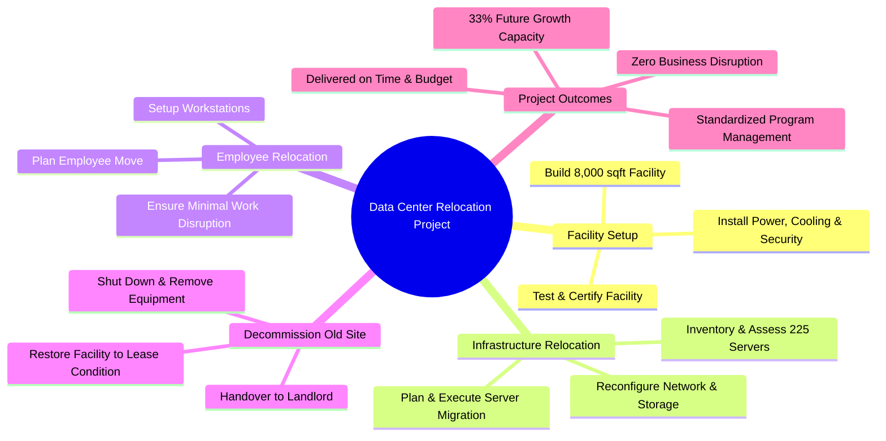
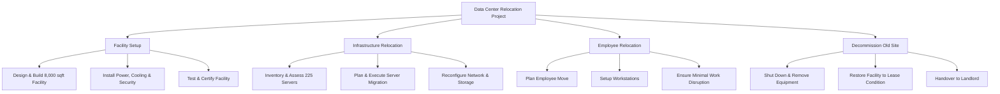
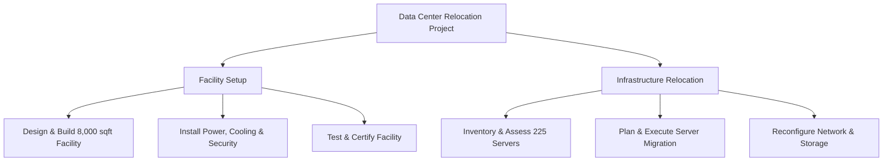
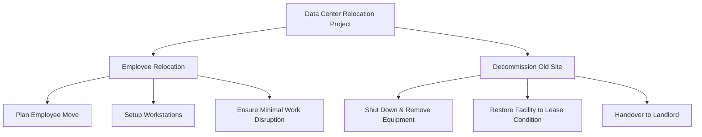
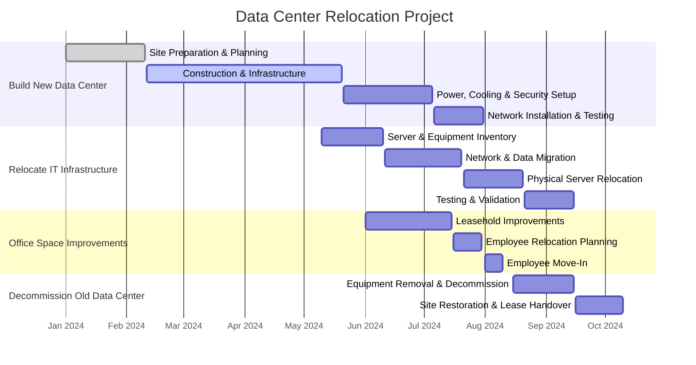
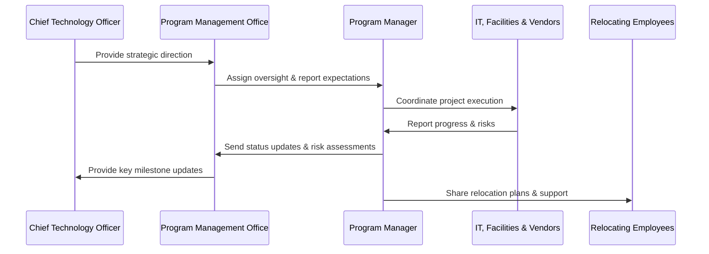

# Scope Picture

# WBS

## Part 1

## Part 2

# Budget
### **Estimated Cost Breakdown by Phases & Activities**
| **Phase & Activities**                                                       | **Estimated Cost (USD)** | **% of Total Budget** |
| ---------------------------------------------------------------------------- | -----------------------: | --------------------: |
| **1. Initiation Phase**                                                      |             **$300,000** |              **5.0%** |
| *Project charter, feasibility study, stakeholder alignment, risk assessment* |               *$150,000* |                *2.5%* |
| *Hiring program manager & key resources*                                     |               *$150,000* |                *2.5%* |
| **2. Planning Phase**                                                        |             **$600,000** |             **10.0%** |
| *Work Breakdown Structure (WBS), risk mitigation, vendor contracts*          |               *$250,000* |                *4.2%* |
| *Communication & contingency planning*                                       |               *$150,000* |                *2.5%* |
| *Detailed infrastructure relocation planning*                                |               *$200,000* |                *3.3%* |
| **3. Execution Phase**                                                       |           **$4,200,000** |             **70.0%** |
| *Construction, power, cooling, security, compliance testing*                 |             *$2,000,000* |               *33.3%* |
| *Server migration (225 servers), network reconfiguration, IT testing*        |             *$1,500,000* |               *25.0%* |
| *Moving logistics, workstation setup, IT support*                            |               *$400,000* |                *6.7%* |
| *Shut down, remove old infrastructure, restore lease conditions*             |               *$300,000* |                *5.0%* |
| **4. Monitoring & Controlling Phase**                                        |             **$600,000** |             **10.0%** |
| *Performance tracking, risk management, compliance audits*                   |               *$400,000* |                *6.7%* |
| *Weekly status meetings, stakeholder reporting*                              |               *$200,000* |                *3.3%* |
| **5. Closure Phase**                                                         |             **$300,000** |              **5.0%** |
| *Final testing, documentation, stakeholder review*                           |               *$200,000* |                *3.3%* |
| *Project handover to operations*                                             |               *$100,000* |                *1.7%* |
| **Total**                                                                    |           **$6,000,000** |              **100%** |
# Gantt Chart

# Risks & Brief Summary
## Brief Summary
**Project Name:** **Data Center Relocation & Infrastructure Upgrade**  
**Project Duration:** **10 months**  
**Budget:** **$6 million**

**Summary:**  
This project involves the design, construction, and migration of IT infrastructure to a new 8,000-square-foot data center to support North American operations. Key activities include building a new facility, relocating 225 servers, migrating network infrastructure, and moving 70 employees from the existing data center. The old data center will be decommissioned and returned to the landlord. The primary objective is to ensure a seamless transition with zero business disruption while enabling a 33% capacity increase for future scalability.
## Risks Table
Here are some key risks associated with this project:

| **Risk Category**     | **Risk Description**                                                                      | **Mitigation Strategy**                                                                                    |
| --------------------- | ----------------------------------------------------------------------------------------- | ---------------------------------------------------------------------------------------------------------- |
| **Technical Risks**   | Unexpected compatibility issues between old and new IT systems could delay migration. | Conduct extensive pre-migration testing in a sandbox environment before full deployment.               |
| **Security Risks**    | Cybersecurity threats could compromise data integrity during server migration.        | Implement strong encryption and access controls; conduct penetration testing before migration. |
| **Resource Risks**    | Lack of in-house expertise in data center relocation may lead to delays.                  | Engage an experienced program manager and external specialists as needed.                          |
| **Vendor Risks**      | Delays in hardware delivery from external vendors may impact the schedule.            | Establish backup suppliers and contingency inventory for critical components.                      |
| **Budget Risks**      | Unexpected costs may arise from additional network infrastructure needs.                  | Maintain a 10-15% contingency fund for unforeseen expenses.                                            |
| **Operational Risks** | Business operations may be disrupted during server migration.                         | Perform migration in phases during off-peak hours to minimize impact.                              |
| **Employee Risks**    | Resistance to change from employees relocating to the new office space.                   | Provide early communication, training, and support for a smooth transition.                    |
| **Schedule Risks**    | Construction delays in building the new facility may push back the migration timeline.    | Use strict milestone tracking and buffer time in the schedule to accommodate potential delays.     |
# Stakeholder Register

| **Stakeholder Name/Group**                          | **Role in Project**                           | **Interest Level** | **Influence Level** | **Engagement Strategy**                      |
| --------------------------------------------------- | --------------------------------------------- | ------------------ | ------------------- | -------------------------------------------- |
| **Chief Technology Officer (CTO) – North America**  | Project Sponsor, Approves major decisions     | High               | High                | Regular status meetings, direct updates      |
| **Global Program Management Office (PMO)**          | Oversees program execution and compliance     | High               | High                | Detailed reporting, risk assessments         |
| **XYZ Program Manager**                             | Leads the entire project execution            | High               | High                | Hands-on management, daily coordination      |
| **IT Infrastructure Team**                          | Handles server migration, network setup       | High               | Medium              | Weekly syncs, testing sessions               |
| **Construction & Facilities Team**                  | Manages data center build-out                 | Medium             | Medium              | Progress tracking, milestone updates         |
| **Network Security Team**                           | Ensures security compliance during migration  | High               | High                | Security assessments, pre-deployment reviews |
| **External Vendors (Hardware & Network Providers)** | Supplies equipment & technical support        | Medium             | High                | Contract negotiations, SLA enforcement       |
| **Company’s Senior Executives**                     | Monitor project impact on business strategy   | Medium             | High                | Monthly executive briefings                  |
| **Employees Moving to New Office Space**            | Affected by relocation & workplace changes    | High               | Low                 | Change management, training, support         |
| **Landlord of Old Data Center**                     | Receives decommissioned site post-move        | Low                | Medium              | Lease termination coordination               |
| **Regulatory & Compliance Bodies**                  | Ensures compliance with data center standards | Low                | High                | Regular compliance checks, documentation     |
# Communications Process

# Quality

| **Quality Area**      | **How Quality Was Tracked** |
|----------------------|---------------------------|
| **Data Center Construction** | **Site inspections, contractor compliance checks, milestone reviews** |
| **IT Infrastructure Deployment** | **Pre-migration testing, load balancing checks, security audits** |
| **Network Performance** | **Latency tests, failover simulations, stress testing** |
| **Server Migration** | **Validation with test environments, post-move functional checks** |
| **Security & Compliance** | **Penetration testing, regulatory audits, encryption validation** |
| **Employee Relocation** | **User feedback surveys, IT support availability post-move** |
## Quality Management Tools:
- Jira for project tracking
- SolarWinds for infrastructure
- Regular penetration testing
- Apache JMeter for testing
- ServiceNow for issue tracking
- Internal surveys to get feedback on new data center quality
## Quality Control
- Regular Checkpoints: Weekly progress meetings with PMO, IT teams, and vendors  
- Risk-Based Testing: Focused quality checks before server migrations  
- Post-Migration Validation: Ensuring systems run as expected before decommissioning old data center  
- Lessons Learned Documentation: Used to improve future data center projects