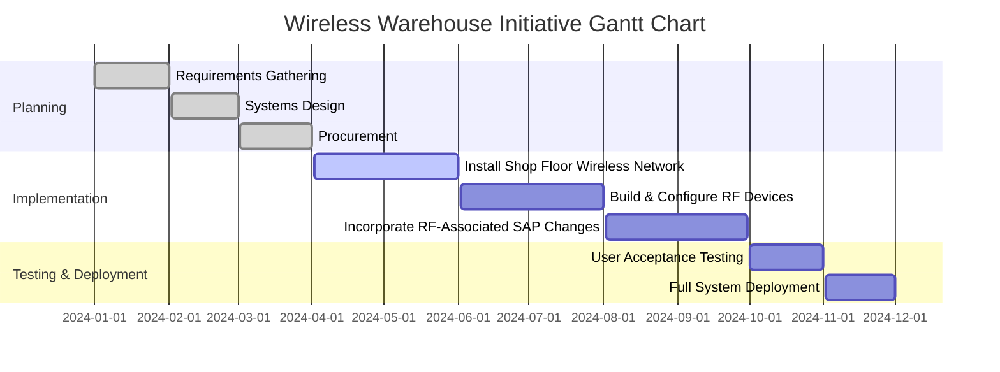

# Scope

This project aimed to enhance materials management operations for an industrial machinery provider in the oil & gas and power generation markets. The primary objective was to improve order accuracy, increase productivity, and reduce costs by integrating radio frequency (RF) automation with SAP’s Supply Chain Management (SCM) software.

The scope included:
- **Installing a shop floor wireless network** to support RF communication.
- **Building, configuring, and connecting RF devices** for automated inventory tracking.
- **Integrating RF-related changes into SAP SCM software** for real-time supply chain visibility.

XYZ provided a senior project manager to oversee project planning, system integration, procurement, and testing during the final phase. The project successfully reduced delivery times by 66% and came in 18% under budget, improving inventory accuracy and setting the stage for future operational enhancements.
# WBS
- Project Management & Planning
    - Develop project plan
    - Define scope, objectives, and milestones
    - Identify stakeholders and assign responsibilities
    - Risk assessment and mitigation planning
- Wireless Network Installation
    - Site survey and network design
    - Procurement of network hardware
    - Installation of wireless access points and infrastructure
    - Network testing and optimization
- RF Device Implementation
    - Selection and procurement of RF devices (scanners, handhelds, etc.)
    - Configuration and software setup for RF devices
    - RF device connectivity and communication setup
    - User training and adoption
- SAP Integration & System Changes
    - Requirements gathering for SAP modifications
    - Development and customization of SAP SCM
    - Testing and validation of SAP-RF integration
    - Data migration and system go-live
- Testing & User Acceptance
    - Unit testing of individual components
    - Integration testing between RF devices and SAP
    - User acceptance testing and feedback integration
    - Performance validation and troubleshooting
- Deployment & Go-Live
    - Final implementation of RF solution
    - Rollout and phased go-live strategy
    - Monitoring and issue resolution
    - Post-implementation review and reporting
- Project Closure & Evaluation
    - Performance assessment against objectives
    - Documentation and knowledge transfer
    - Lessons learned and future improvement recommendations
# Cost Estimates
| **Phase & Activities**                | **Estimated Cost (USD)** | **% of Total Budget** |
| ------------------------------------- | ------------------------ | --------------------- |
| **1. Initiation Phase**               | **$60,000**              | **8.0%**              |
| *Project Management & Planning*       | *$60,000*                | *8.0%*                |
| **2. Planning Phase**                 | **$130,000**             | **17.3%**             |
| *Wireless Network Installation*       | *$130,000*               | *17.3%*               |
| **3. Execution Phase**                | **$510,000**             | **68.0%**             |
| *RF Device Implementation*            | *$160,000*               | *21.3%*               |
| *SAP Integration & System Changes*    | *$210,000*               | *28.0%*               |
| *Testing & User Acceptance*           | *$90,000*                | *12.0%*               |
| *Contingency Budget*                  | *$50,000*                | *6.7%*                |
| **4. Monitoring & Controlling Phase** | **$110,000**             | **14.7%**             |
| *Deployment & Go-Live*                | *$110,000*               | *14.7%*               |
| **5. Closure Phase**                  | **$55,000**              | **7.3%**              |
| *Project Closure & Evaluation*        | *$55,000*                | *7.3%*                |
| **Total**                             | **$750,000**             | **100%**              |
# Gantt Chart

# Risks
| **Risk**                           | **Summary** |
|------------------------------------|------------|
| **Technology Integration Issues**  | Integrating RF automation with SAP SCM software may encounter compatibility or performance issues, leading to delays or increased costs. |
| **Implementation Delays**          | Hardware procurement, network installation, or software configuration may take longer than expected, impacting the project schedule. |
| **Budget Overruns**                | Unexpected costs in procurement, installation, or labor could exceed initial estimates, affecting financial planning. |
| **System Downtime During Deployment** | Transitioning to the new system may cause temporary warehouse disruptions, leading to operational inefficiencies. |
| **User Adoption & Training Challenges** | Employees may struggle to adapt to the new RF system, requiring additional training and impacting initial productivity. |
| **Data Accuracy & Migration Issues** | Errors in transferring or integrating existing inventory data into the new system could lead to inventory discrepancies. |
| **Security & Compliance Risks**     | Wireless networks could introduce cybersecurity vulnerabilities, and the system must comply with industry regulations. |
| **Vendor & Supplier Dependencies**  | Delays from hardware or software vendors could disrupt the implementation timeline. |
# Stakeholder Registry
| **Stakeholder**                   | **Role**                     | **Interest** | **Influence** | **Engagement Strategy** |
|------------------------------------|------------------------------|-------------|--------------|-------------------------|
| **Project Sponsor (Company Leadership)** | Provides funding and strategic direction | High | High | Regular status updates, strategic alignment meetings |
| **Project Manager (XYZ Consulting)** | Oversees project execution, scheduling, and vendor management | High | High | Daily stand-ups, progress reports, risk management meetings |
| **Warehouse Staff**                | End users of the RF automation system | High | Medium | Training sessions, feedback loops, hands-on testing |
| **IT Department**                  | Manages SAP integration and system security | Medium | High | Technical workshops, system testing, risk mitigation meetings |
| **Vendors & Suppliers**            | Provide RF hardware and SAP integration support | Medium | Medium | Contract agreements, milestone check-ins, delivery follow-ups |
| **Logistics & Supply Chain Team**  | Ensure seamless inventory and shipping operations | High | Medium | Workflow adjustments, hands-on training, feedback collection |
| **Regulatory & Compliance Officers** | Ensure legal and industry compliance | Low | High | Compliance audits, documentation reviews, security assessments |
| **Customers**                      | Indirect stakeholders benefiting from faster delivery times | Medium | Low | Customer feedback surveys, performance reports |
# Quality
### **1. Key Performance Indicators (KPIs)**
- **Delivery Speed**: Tracked before and after implementation (e.g., reduction from 24 hours to 8 hours).
- **Inventory Accuracy**: Compared manual vs. automated data entry results.
- **Error Reduction**: Monitored decrease in shipping and receiving errors.
- **System Downtime**: Measured uptime and disruptions during implementation.
### **2. System Testing & Validation**
- **User Acceptance Testing (UAT)**: Warehouse staff tested RF devices and SAP integration before deployment.
- **Pilot Testing**: The RF system may have been tested on a small scale before full rollout.
- **Regression Testing**: Ensured new automation didn’t disrupt existing operations.
### **3. Stakeholder Feedback**
- **Warehouse Staff Input**: Identified usability issues and performance concerns.
- **Logistics & Supply Chain Reports**: Assessed accuracy and speed improvements.
- **Customer Feedback**: Indirect measurement of improved delivery speed.
### **4. Compliance & Audit Reviews**
- **Regulatory Compliance Checks**: Ensured adherence to industry standards.
- **Security Audits**: Verified the integrity of wireless networks and SAP integration.
### **5. Budget & Schedule Monitoring**
- **Variance Analysis**: Tracked actual costs and time vs. planned estimates.
- **Risk Mitigation Reports**: Addressed delays or cost overruns proactively.